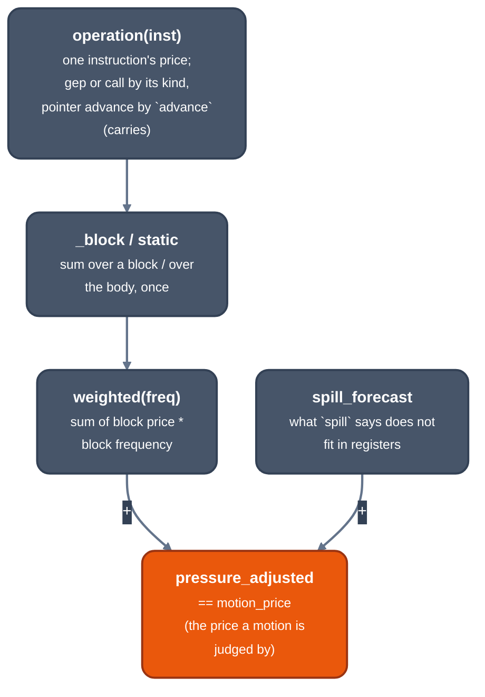

> Generated from the `//!` header of [`crates/opt/llrm-transforms/src/profit.rs`](https://github.com/ali-mosavian/llrm/blob/main/crates/opt/llrm-transforms/src/profit.rs); edit the header, not this file.
<!-- src: crates/opt/llrm-transforms/src/profit.rs sha256:45c9072a853f3c6f3baf321b7aab1c65c30c218f62632fe7b607d4a425a55968 -->

# profit

Machine-neutral profitability shared by the MIR transforms: what an
instruction, a block and a function cost under a target's prices, how often
each block runs, and what registers cost past the target's.

## How it works
Everything here prices semantic work: opcodes, memory effects and CFG
frequency. A kind of instruction without a price makes the answer `None`,
unknown rather than cheap, and a transform that copies code leaves a
function it cannot price alone (`priced`).

The machine's facts come in as parameters: each operation's price
(`OperationCosts`, from the target by `costs`), how many integer values fit
in registers and across a call (`registers`, `Room`), and that floating
values do not take that room.



*How the price a motion is judged by is built*

Frequencies come in two models, both per entry:
- `_frequencies`: `branchprob`'s estimate in `UNIT`ths of an execution
  (never below one, so a cold arm is near free but ordered), with each
  loop's proven trips (`proven_trips`, from ScalarEvolution's
  `getSmallConstantTripCount`) in place of its estimate;
- `_loop_products`: the trips of each loop around a block multiplied, with
  `UNKNOWN_TRIPS` (ten) for a loop ScalarEvolution does not count. `lsr` and
  `gvn` were tuned on it (#202, #203). `_loop_products_by_branch` weighs
  each block by the share of its loop's trips that reach it.

`site` is `peelsize`'s view of a loop: how often it is entered and
whether it calls what may touch memory, from frequencies worked out once
per version of the function (`Frequencies`).

Prices of what has no instruction: a `llvm.memset` call is a fill, its
bytes the cells, `fill + cells * fill_cell`; a `select` is a branch and a
move, and has no cheaper form here; `frem`, `landingpad` and other kinds
the target does not price are `None`. A load or store touches memory, so no
operation carries a folded memory operand.

## Example
```mir
define double @f(double %x) {
b0:
  %y = frem double %x, 3.000000e+00
  ret double %y
}
```
Facts:
```text
profit::static(@f, OperationCosts::default()) = None
```
The body has an instruction no price covers, so the answer is `None`, not a
small number.

From unit test `an_unpriced_instruction_makes_the_body_unpriced` in
`profit_tests.rs`.

## Provides
`costs`, `registers`, `operation`, `static`, `priced`, `weighted`,
`spill_forecast`, `pressure_adjusted`, `motion_price`, `advance`, `site`,
`proven_trips`, the frequency models and `UNIT`, `UNKNOWN_TRIPS`.

## Used by
Each of [`crate::lsr_pass`](lsr_pass.md), [`crate::hoist`](https://github.com/ali-mosavian/llrm/blob/main/crates/opt/llrm-transforms/src/licm/hoist.rs), [`crate::gvn`](gvn.md),
[`crate::loopunrollpass`](loopunrollpass.md), [`crate::looppeel`](looppeel.md),
[`crate::loopidioms`](loopidioms.md), [`crate::window`](window.md), [`crate::gepoffset`](gepoffset.md),
[`crate::indvars`](indvars.md), [`crate::ipacp`](ipacp.md), [`crate::inline`](inline.md)
and [`crate::interprocedural`](../analyses/interprocedural.md) asks it, before a rewrite that trades code
size or registers for speed, whether the rewrite pays. Not a pass: it runs
only inside those.

## Needs
The target's `OperationCosts` and registers, [`crate::spill`](spill.md) for the
forecast, `branchprob` and `induction` for the frequencies.
