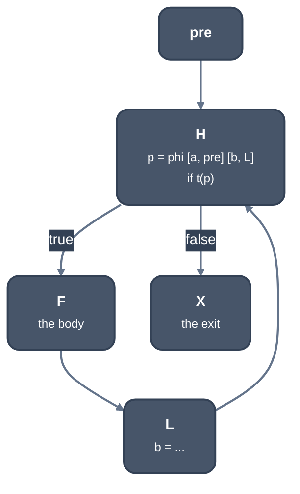
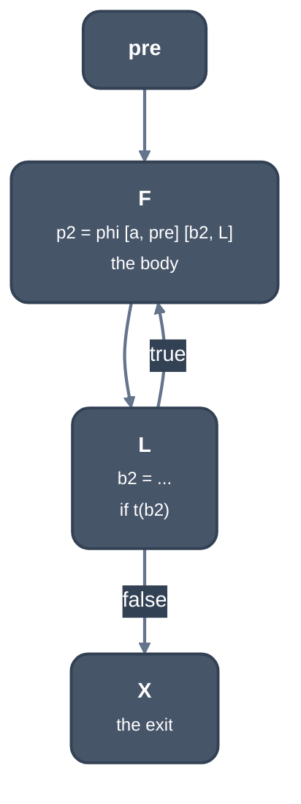

> Generated from the `//!` header of [`crates/opt/llrm-transforms/src/rotate.rs`](https://github.com/ali-mosavian/llrm/blob/main/crates/opt/llrm-transforms/src/rotate.rs); edit the header, not this file.
<!-- src: crates/opt/llrm-transforms/src/rotate.rs sha256:4f490b55e175715129593db7145448bd6c1ce76f470b17676a3b2e31cffd29b4 -->

# rotate

Loop rotation: a loop proven to run at least once is entered at its body,
not its test; a loop that is not proven is entered behind a copy of its
test (gcc's `-ftree-ch`).

## How it works
A rotatable loop (`Shape`) has one preheader that jumps only to the header;
one latch that goes only back to the header; a header that holds the exit
test, a conditional branch to the first body block `first` and to the
exit; and a `first` reached from nowhere else, with no phis. What the
header computes besides its phis must be test-only (compares, casts, geps,
selects; a division only where the test is copied before the loop, so
skipping it on entry skips no trap), and a value a header phi takes round
the back edge, a counter's step, is not test-only.

`_rotate` moves the header's phis to `first`: `p(preheader: a, latch: b)`
becomes `p'(preheader: a, header: b')`, phis read in parallel so a swap
needs no order. `ssa::SsaUpdater` rewrites every other use, outside the loop
included: the body reads `p'`, the header and what follows the loop read
`a` as it left the preheader and `b'` as it left the latch. Afterwards the
test is reached only from the latch, and `cfg::merged` merges it into it.



*Before: the test is in the header*



*After: rotated, the test is in the latch*

Two modes, set by the fields of `Rotate`:
- `proven` (`rotated`): the loop has a proven trip count
  (`induction::trip_count`), so its first test passes. The entry goes
  straight to the body. A loop of none or of an unknown count keeps its
  first test.
- `copy` (`copied`): a loop not proven to run is entered behind a copy of
  its test, in the preheader, which skips the loop to the exit when it fails
  (gcc's `should_duplicate_loop_header_p`: a header that ends in the exit
  test and computes only test values). A loop with a known trip count is
  left to `proven`. The header may have at most 20 instructions besides phis
  (`param_max_loop_header_insns`); a chain of header tests (`while (a &&
  b)`) is copied test by test within what is left of that budget. The guard
  takes the loop test's branch weights, else the loop heuristic's, so the
  way into the loop is laid out as the likely one.

The copy is on at -O1 and up, not at -Os (`-fno-tree-ch` turns it off): the
user's decision of 2026-10-12 (docs/reference/levels.md) accepts its compile
cost (+9.3% at -O1, +14.0% at -O2 over the vsgcc programs) and the m16 bench
rows it moves (#1557); the steeper slopes of rotate, loopslots and
`analysis registers` on nests and many-loop functions are #1559.

A rotated loop is no longer the pre-tested shape the counted-loop
analyses, [`crate::looppeel`](looppeel.md) and [`crate::loopunrollpass`](loopunrollpass.md) read, so
rotation goes after them. [`crate::lsr_pass`](lsr_pass.md) enters a loop it counts to
zero at its body too, behind a skip guard, with the same `_rotate`.

## Example
Before:
```mir
define ... @"_sum@3"(ptr nocapture readonly %0, i16 %1) ... {
b1:
  br label %b2

b2:
  %2 = phi i16 [ 0, %b1 ], [ %10, %b4 ]
  %3 = phi i16 [ 0, %b1 ], [ %9, %b4 ]
  %4 = icmp slt i16 %2, %1
  br i1 %4, label %b4, label %b3

b3:
  %5 = phi i16 [ %3, %b2 ]
  ret i16 %5

b4:
  %6 = mul i16 %2, 2
  %7 = getelementptr inbounds i8, ptr %0, i16 %6
  %8 = load i16, ptr %7, !tbaa !9
  %9 = add nsw i16 %3, %8
  %10 = add nsw i16 %2, 1
  br label %b2
}
```
After:
```mir
define ... @"_sum@3"(ptr nocapture readonly %0, i16 %1) ... {
b1:
  %2 = icmp slt i16 0, %1
  br i1 %2, label %b4, label %b3, !prof !24

b3:
  %3 = phi i16 [ %9, %b4 ], [ 0, %b1 ]
  ret i16 %3

b4:
  %4 = phi i16 [ 0, %b1 ], [ %9, %b4 ]
  %5 = phi i16 [ 0, %b1 ], [ %10, %b4 ]
  %6 = mul i16 %5, 2
  %7 = getelementptr inbounds i8, ptr %0, i16 %6
  %8 = load i16, ptr %7, !tbaa !9
  %9 = add nsw i16 %4, %8
  %10 = add nsw i16 %5, 1
  %11 = icmp slt i16 %10, %1
  br i1 %11, label %b4, label %b3
}
```
The loop test is copied into the preheader (`%2`) as a guard. The header
phis moved into the body `b4`, and the test now sits at the latch, so each
trip runs one branch.

From `--dump` of `sum` (`for (i = 0; i < n; i++) s += a[i];`) at -O2 -m16
-ftree-ch, stages `calleepop` and `rotate`.

## Runs
Twice in [`crate::pipeline`](pipeline.md), outside the per-body fixed point. `copy` runs
with `copy_headers` (`-ftree-ch`, on at -O1 and up, `-fno-tree-ch` turns it
off) and not at `-Os`, after the interprocedural step and before
`fixednarrow`, followed by loop simplification, LCSSA and cleanup. `proven`
always runs, last of the loop passes, after `window`. `LLRM_DEBUG=census`
prints what the trip-count analyses prove per loop, to compare builds with
and without `-ftree-ch`.

On by default is the user's decision of 2026-10-12
(docs/reference/levels.md): compile +9.3% at -O1 and +14.0% at -O2 over the
vsgcc programs, the m16 bench rows it moves (#1557), and steeper slopes of
rotate, loopslots and `analysis registers` on nests and many-loop functions
(#1559).

## Keeps
Nothing where it changes a body.

## See also
gcc's `pass_ch` (`tree-ssa-loop-ch.cc`) and LLVM's LoopRotate.
