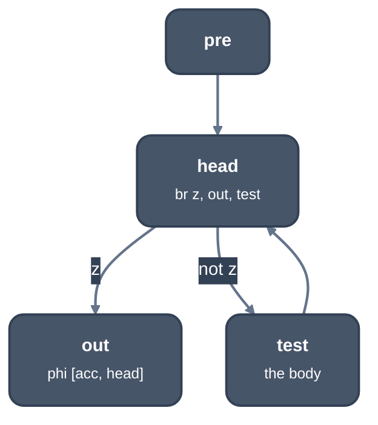
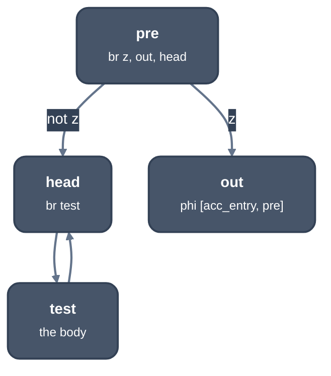

> Generated from the `//!` header of [`crates/opt/llrm-transforms/src/trivialunswitch.rs`](https://github.com/ali-mosavian/llrm/blob/main/crates/opt/llrm-transforms/src/trivialunswitch.rs); edit the header, not this file.
<!-- src: crates/opt/llrm-transforms/src/trivialunswitch.rs sha256:35c3d23e8d2c4d3e7d369252859050b6e6c48d711854505b9b15bf403ba627c1 -->

# trivialunswitch

A branch in a loop's header on a loop-invariant condition, one side of
which leaves the loop, is decided in the preheader instead of on every
trip.

## How it works
The loop needs one preheader that jumps only to the header. The header's
terminator is a conditional `br` on a value defined outside the loop, with
one target outside the loop (the exit) and one inside. Whichever way the
branch goes on the first trip it goes on every trip, so the preheader takes
that branch and the header falls through to the loop body.

Nothing is copied. Three conditions keep the move sound:
- What the header computes before its branch is phis and work that can be
  speculated, because it is skipped where the loop is never entered.
- A value the loop defines is used outside it only by the exit's phis.
- The exit's phis take their value on the new edge from a value defined
  outside the loop, or from a header phi's value on entry. Any other value
  the loop computes is not there yet, and keeps the branch.



*Before: the header tests z on every trip*



*After: the preheader tests z once*

Tail recursion makes such loops: `paths(n, m)` tests `n == 0` on every trip
of the loop that tests `m == 0`. A condition inside the body, or a branch
that stays in the loop on both sides, is [`crate::simpleloopunswitch`](simpleloopunswitch.md)'s,
which copies the loop.

A rotated loop, one whose header jumps back to itself, is left alone (TU1).

The pass repeats while a loop changes.

## Example
Before:
```mir
define ... @pipeline.body(ptr nocapture readonly %0, i16 %1, i16 %2) ... {
  ; ...
  %9 = load i16, ptr %4, !tbaa !9
  %10 = icmp eq i16 %9, 0
  %11 = zext i1 %10 to i16
  %12 = load i16, ptr %5, !tbaa !9
  %13 = load ptr, ptr %3, !tbaa !21
  br label %b2

b2:
  br i1 %10, label %b4, label %27
  ; ...
```
After:
```mir
define ... @pipeline.body(ptr nocapture readonly %0, i16 %1, i16 %2) ... {
  ; ...
  %9 = load i16, ptr %4, !tbaa !9
  %10 = icmp eq i16 %9, 0
  %11 = zext i1 %10 to i16
  %12 = load i16, ptr %5, !tbaa !9
  %13 = load ptr, ptr %3, !tbaa !21
  br i1 %10, label %b2, label %27

b2:
  br label %b4
  ; ...
```
`%10` is `z == 0`, defined outside the loop, and `b2` is the loop's header.
The preheader now takes the branch to the exit `27` or into the loop, and
`b2` goes straight to the body `b4`.

From `--dump` of `scan` (`while (z == 0) { if (i >= n) break; s += a[i];
i++; }`) at -O2 -m16, stages `hoist` and `trivialunswitch` (frame slots and
the loop body left out).

## Runs
In the function pipeline's fixed point, after `loopmotion` and before
`gvn`. At every level above -O0; there is no flag for it alone.

## Needs
The loop shape ([`crate::loopsimplify`](loopsimplify.md) gives the preheader) and callees'
effects, to tell work that can be speculated.

## Keeps
Nothing: a change invalidates every analysis.

## See also
LLVM's SimpleLoopUnswitch, trivial form (`unswitchTrivialBranch`). It
follows a chain of blocks that each continue unconditionally; this pass
looks only at the header.
