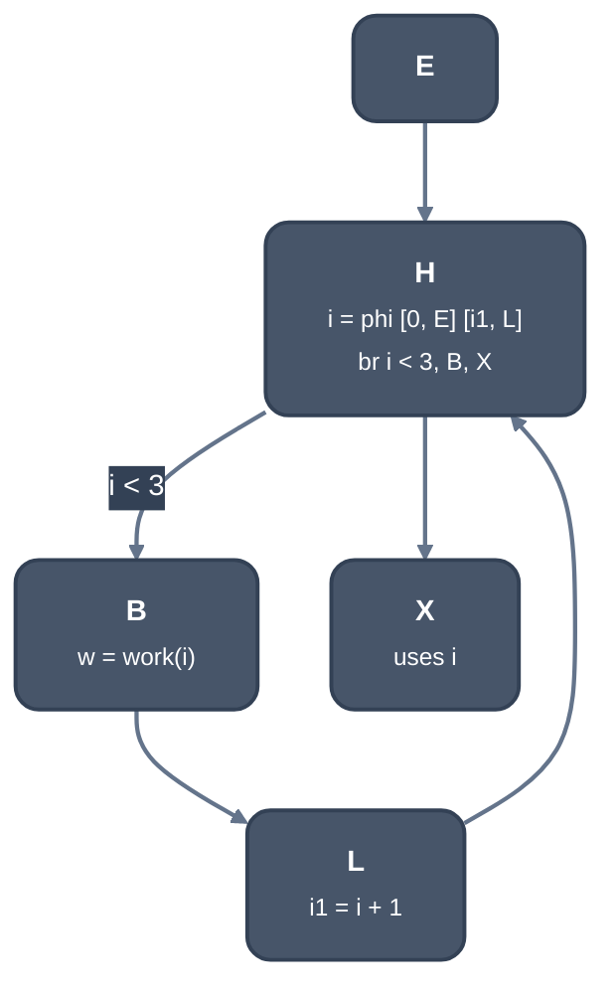
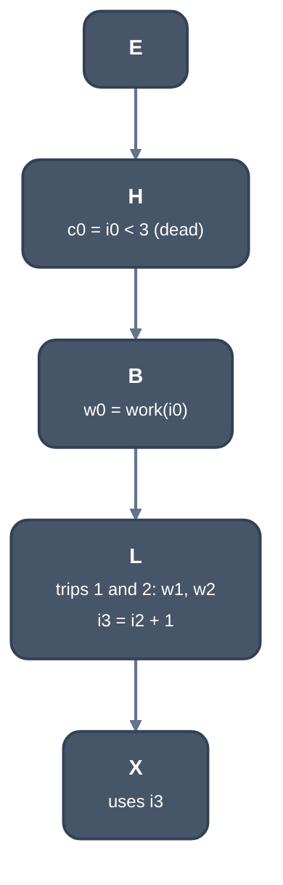

> Generated from the `//!` header of [`crates/opt/llrm-transforms/src/unroll.rs`](https://github.com/ali-mosavian/llrm/blob/main/crates/opt/llrm-transforms/src/unroll.rs); edit the header, not this file.
<!-- src: crates/opt/llrm-transforms/src/unroll.rs sha256:052ed9110374887073fcba4ac2fc89ac34bca80d5665c130c990f5d514148dd0 -->

# unroll

Full unrolling of a loop with an exact trip count of at least two: its
trips become one straight line in the latch and the loop is gone.

## How it works
A loop qualifies when it has one latch and one entering block; its header
tests with a conditional `br` whose one successor is the body and the other
the exit; the exit has the header as its only predecessor; the body is a
chain of single-successor blocks from the header to the latch with no
phis; and every header phi has exactly the two arms, entry and latch.
The body and latch may not call out (`calls_out`) or touch volatile memory.
The header's work runs once more than the body, so it may not store, call
or allocate. ScalarEvolution (`getSmallConstantTripCount`) must prove the
count, and `peelsize::admitted` (in `llrm_analysis`) must price it as worth
copying: the budgets, the hint a language may state, and the reasons it
refuses are documented there.

The first trip is the original blocks. Each later trip is a clone of the
header's work and of the body's, appended in the latch before its jump,
with operands renamed to the previous trip's values; the header phis'
latch arms are what carry a value from one trip to the next. A last clone
of the header's work supplies what the exit reads. Then the header phis are
replaced by their entry values and erased, the header's test becomes a
`br` to the body, and the latch jumps to the exit.



*Before: a loop of three trips*



*After: the trips are one straight line, the back edge is gone*

Uses outside the loop are rewritten to the last trip's values. The
comparisons left behind are removed by `dead`, and constants that appear
(a copy's indices) by `fold` and the rest of the fixed point.

A function holding an instruction the target does not price
(`profit::priced`) is left alone. The pass expands one loop at a time and
starts again, so a loop around an expanded one may follow. A loop `peelsize`
refused is not priced again while its blocks are unchanged.

Loops with a branch in the body are copied by [`crate::peel`](peel.md) instead; a
nest's outer loop can be unrolled only by [`crate::unroll_jam`](unroll_jam.md).

`LLRM_DEBUG=unroll` prints one line per loop priced (size, unrolled size,
boost, undecided branches, and the reason for a refusal; or "admitted")
and `expanded a loop` for each loop copied.

## Example
Before:
```mir
define ... @pipeline.body() ... {
b1:
  br label %0

0:
  %1 = phi i16 [ 0, %b1 ], [ %11, %6 ]
  %2 = phi i16 [ 0, %b1 ], [ %10, %6 ]
  %3 = icmp slt i16 %1, 2
  br i1 %3, label %6, label %4

4:
  %5 = phi i16 [ %2, %0 ]
  ret i16 %5

6:
  %7 = mul i16 %1, 2
  %8 = getelementptr inbounds i8, ptr @_a, i16 %7
  %9 = load i16, ptr %8, !tbaa !9
  %10 = add nsw i16 %2, %9
  %11 = add nsw i16 %1, 1
  br label %0
}
```
After:
```mir
define ... @pipeline.body() ... {
  ; ...
0:
  %1 = icmp slt i16 0, 2
  br label %4

2:
  %3 = phi i16 [ %14, %4 ]
  ret i16 %3

4:
  %5 = mul i16 0, 2
  %6 = getelementptr inbounds i8, ptr @_a, i16 %5
  %7 = load i16, ptr %6, !tbaa !9
  %8 = add nsw i16 0, %7
  %9 = add nsw i16 0, 1
  %10 = icmp slt i16 %9, 2
  %11 = mul i16 %9, 2
  %12 = getelementptr inbounds i8, ptr @_a, i16 %11
  %13 = load i16, ptr %12, !tbaa !9
  %14 = add nsw i16 %8, %13
  %15 = add nsw i16 %9, 1
  %16 = icmp slt i16 %15, 2
  br label %2
}
```
Both trips are in the old latch, with the header phis replaced by their
entry values. The comparisons `%1`, `%10` and `%16` stay for `dead`.

From `--dump` of `total` (`return sum(a, 2)`, `sum` a static `for (i = 0; i
< n; i++)` loop, inlined) at -O2 -m16: `interprocedural/01`, stages `decide`
and `unroll`.

## Runs
In the pipeline's fixed point, after each round of scalar passes and when
the body changed since the last time it found nothing. After it expands a
loop, `sroa` runs first (a copy's constant indices are new exact leaves),
then the scalar passes. On at -O1 and above and -Os; off at -Oz and by
`-fno-unroll-loops`. A copy may grow the code only where
`Limits::grows`: -O3 and -Omax (`target_percent` 200). Elsewhere a copy
must be no larger than the loop. See `docs/reference/levels.md`.

## Needs
`induction` (trip count), `peelsize`, `consts` and `Registers`
(`llrm_analysis`); [`crate::profit`](profit.md) for prices and the site.

## Keeps
Nothing: a change invalidates every analysis.

## See also
LLVM's LoopUnroll, full unroll (`UnrollLoop` at the trip count; cost model
`analyzeLoopUnrollCost`); gcc's `try_unroll_loop_completely`.
