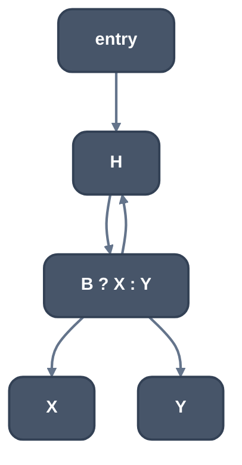
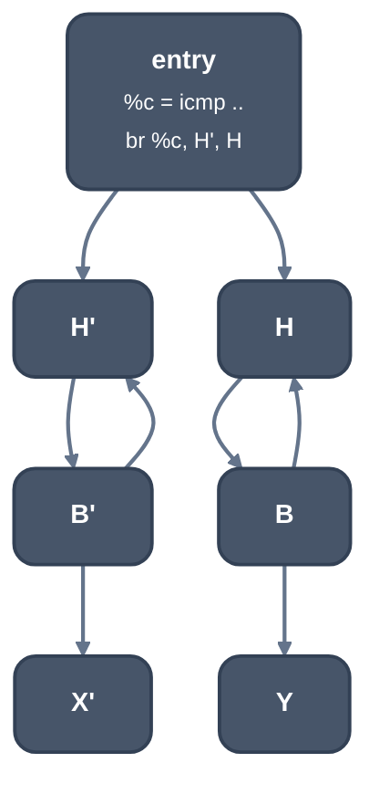

> Generated from the `//!` header of [`crates/opt/llrm-transforms/src/unswitch.rs`](https://github.com/ali-mosavian/llrm/blob/main/crates/opt/llrm-transforms/src/unswitch.rs); edit the header, not this file.
<!-- src: crates/opt/llrm-transforms/src/unswitch.rs sha256:960192a4fd43647634a2919239ffeed58225551405a1be351e879577bc526858 -->

# unswitch

A loop with an invariant branch in its body becomes two loops, one per
way the condition goes, chosen by one test before them.

## How it works
A candidate is a loop with one block outside it entering the header
(the entry), at most 128 operations, and in its body (not the header) a
block ending in a conditional `br` on an `icmp` whose operands are not
defined in the loop and whose definitions dominate the entry. The
first such branch of the first such loop is taken. The comparison is pure
by construction: an `icmp` reads only values.

The pass works on a copy of the function with the loops closed
([`crate::lcssa`](lcssa.md)). [`crate::loopclone`](loopclone.md)'s `peeled` makes one clone of the
loop; the entry gets a copy of the comparison and a `br` on it to the
clone's header (condition holds) or the original header (it does not). In
the clone the branch is replaced by its true arm; in the original by its
false arm. The clone's latch goes back to the clone's header, so each
version is a loop of its own, and the arm each no longer takes is
unreachable and removed.



*Before*



*After: entry tests %c = icmp ..*

The copy is a candidate, not yet a result. It is run through the same
pipeline with unswitching and unroll-and-jam off (`Unswitch::passes`),
then judged against the original. It is kept only if it has fewer loops,
no more operations, and a no larger price: [`crate::profit::weighted`](profit.md) at
the target's operation costs, each block weighted by the trips induction
proves. A body holding an operation the target does not price is never
better. Otherwise the original stays untouched.

## Example
Before:
```mir
define i16 @f(i16 %n, i16 %k) {
b0:
  br label %b1

b1:
  %i = phi i16 [ 0, %b0 ], [ %next, %b4 ]
  %sum = phi i16 [ 0, %b0 ], [ %total, %b4 ]
  %more = icmp ult i16 %i, %n
  br i1 %more, label %b2, label %b5

b2:
  %flag = icmp eq i16 %k, 0
  br i1 %flag, label %b3, label %b4

b3:
  %bumped = add i16 %sum, %i
  br label %b4
  ; ...
}
```
After:
```mir
define i16 @f(i16 %n, i16 %k) {
b0:
  %0 = icmp eq i16 %k, 0
  br i1 %0, label %12, label %11

b1:
  %i = phi i16 [ 0, %11 ], [ %next, %b4 ]
  ; ...
b2:
  %flag = icmp eq i16 %k, 0
  br label %b4
  ; ...
1:
  %2 = phi i16 [ 0, %12 ], [ %10, %9 ]
  %3 = phi i16 [ 0, %12 ], [ %8, %9 ]
  ; ...
5:
  %6 = icmp eq i16 %k, 0
  br label %7

7:
  %8 = add i16 %3, %2
  br label %9
  ; ...
}
```
The test of `%k` is made once, in `b0`. `b1` to `b4` are the loop for `k !=
0`, with the arm that adds gone; `1` to `9` are the copy for `k == 0`, whose
branch is now the add alone. The pipeline then keeps this candidate only if
it has fewer loops and no higher price.

From unit test `test_an_invariant_branch_specializes_the_loop` in
`unswitch_tests.rs`, the candidate `specialized` makes, before it is
re-optimized.

## Runs
Once per body, after the fixed point and the peel rounds settle and before
unroll-jam. -O3 only: `-funswitch-loops`. -Omax does not set it.

## Needs
[`crate::lcssa`](lcssa.md), [`crate::loopclone`](loopclone.md), [`crate::profit`](profit.md), and the
target's operation costs.

## Keeps
Nothing when it unswitches: the function is replaced by the candidate.

## See also
A branch in the header that leaves the loop is
[`crate::trivialunswitch`](trivialunswitch.md)'s: nothing is copied. gcc's
`tree-ssa-loop-unswitch.cc`; LLVM's SimpleLoopUnswitch, non-trivial form.
