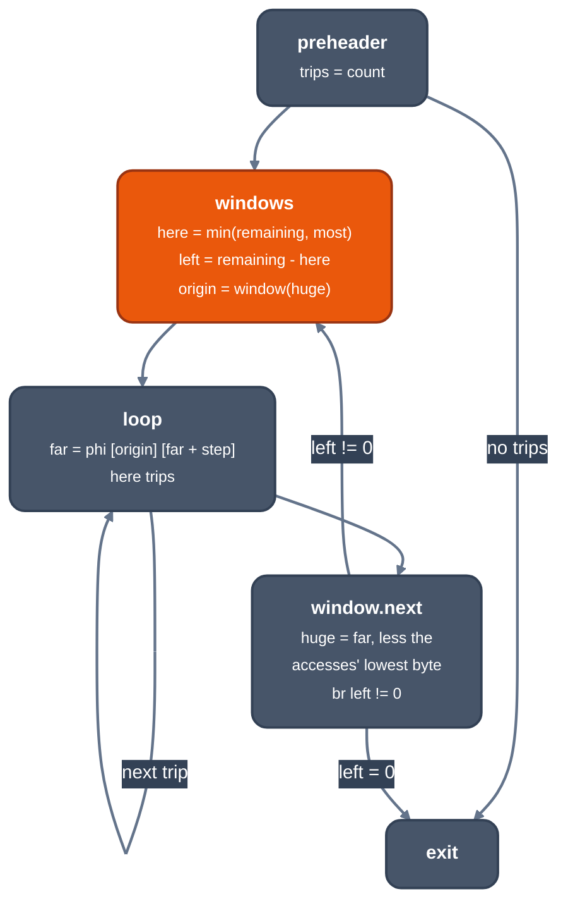

> Generated from the `//!` header of [`crates/opt/llrm-transforms/src/window.rs`](https://github.com/ali-mosavian/llrm/blob/main/crates/opt/llrm-transforms/src/window.rs); edit the header, not this file.
<!-- src: crates/opt/llrm-transforms/src/window.rs sha256:b9e0f309bbbac4c14b6036b36c9c631801cea03298a4d20d1c580c038655c1d1 -->

# window

A counted loop's huge pointers are split into windows, inside each of which
the loop runs on far pointers that never carry into the segment selector.

## How it works
A huge pointer's step carries into the selector, so each step costs the
carry. The target names a window (`Machine::huge_window`: the far address
space, and the number of bytes from a normalized far pointer that no
displacement carries out of); a target without one is left alone. On the
16-bit x86 target it is 64K less one selector step's last byte.

The loop must have one preheader and one latch, and a counted-loop proof
from `induction` whose test is the header's (before each trip) or the
latch's (after). Its walks are the huge pointer recurrences with a
constant step, read only by their own step and by loads and stores at
constant offsets from them. A walk's `fixed` is the span of bytes its
accesses reach beyond the steps; `most`, the trips one window holds, is
the least over the walks of `(window - fixed) / |step|`, and must be at
least 2.

Where the trips provably fit one window (`count <= most`) nothing is
split: each walk is normalized once before the loop by the call
`llrm.ia16.window` (`Intrinsic::Window`), which returns the far pointer
with the lowest offset, and the loop keeps its own test but steps the far
pointer.

Otherwise an outer loop walks the windows:



*The windows: one far-pointer loop inside each window*

Every other header phi is carried across windows by a phi in `windows`.
The exit's phis read the outer latch; values the loop computes may be read
outside only by the exit's phis. A walk down is normalized at its last
trip's lowest byte.

The split is priced. Each window normalizes every walk (three adds each)
and past the first steps it on as a huge pointer, besides its count and
test; it saves one carry step per walk per trip. For time, trips times the
saving must exceed the windows (`trips / most`, rounded up) times the setup,
where an unknown count is taken as its bound or `profit::UNKNOWN_TRIPS`.
For size (-Os), the saving must exceed one setup. A loop that fails is
left alone. The new branches carry `branch_weights`.

DEVIATE LP-4 (no pin pass: huge-pointer windows are the DOS exception, LLVM
has no huge pointer; exit: none planned, kept; to migrate off the old
analyses it reads; owner w-6; review 2026-11-27).

## Example
Before:
```mir
define ... @"_clear@3"(ptr addrspace(3) nocapture writeonly %0, i16 %1) ... {
b1:
  %2 = sub i16 0, %1
  %3 = icmp ule i16 %1, 0
  br i1 %3, label %b3, label %5

b3:
  ret void

b4:
  %lsr.iv2 = phi ptr addrspace(3) [ %lsr.iv.next, %b4 ], [ %0, %5 ]
  %lsr.iv11 = phi i16 [ %lsr.iv.next1, %b4 ], [ %2, %5 ]
  store i8 0, ptr addrspace(3) %lsr.iv2, !tbaa !7
  %lsr.iv.next = getelementptr i8, ptr addrspace(3) %lsr.iv2, i32 1
  %lsr.iv.next1 = add i16 %lsr.iv11, 1
  %4 = icmp ne i16 %lsr.iv.next1, 0
  br i1 %4, label %b4, label %6

5:
  br label %b4

6:
  br label %b3
}
```
After:
```mir
define ... @"_clear@3"(ptr addrspace(3) nocapture writeonly %0, i16 %1) ... {
  ; ...
b4:
  %window.trips = phi i16 [ %14, %windows ], [ %5, %b4 ]
  %window = phi ptr addrspace(1) [ %4, %b4 ], [ %15, %windows ]
  store i8 0, ptr addrspace(1) %window, !tbaa !7
  %4 = getelementptr i8, ptr addrspace(1) %window, i16 1
  %5 = sub i16 %window.trips, 1
  %6 = icmp ne i16 %5, 0
  br i1 %6, label %b4, label %window.next, !prof !24

window.next:
  %7 = addrspacecast ptr addrspace(1) %4 to ptr addrspace(3)
  %8 = icmp ne i16 %16, 0
  br i1 %8, label %windows, label %17, !prof !25
  ; ...
windows:
  %remaining = phi i16 [ %12, %9 ], [ %16, %window.next ]
  %carried = phi ptr addrspace(3) [ %0, %9 ], [ %7, %window.next ]
  %13 = icmp ult i16 %remaining, -16
  %14 = select i1 %13, i16 %remaining, i16 -16
  %15 = call ptr addrspace(1) @llrm.ia16.window.p1.p3(ptr addrspace(3) %carried)
  %16 = sub i16 %remaining, %14
  br label %b4
  ; ...
```
The huge pointer `%lsr.iv2` becomes a far pointer `%window` that steps
inside `b4`. Each trip of `windows` normalizes the pointer with
`llrm.ia16.window` and runs at most 65520 trips (`-16`) before the next
window.

From `--dump` of `clear` (`char huge *p; for (i = 0; i < n; i++) p[i] = 0;`)
at -O2 -m16, stages `differences` and `window`.

## Runs
Once per function, after LSR chose the pointers (the windows are made over
its recurrences) and before the final `rotate`. Off at -O0 and by
`-fno-strength-reduce`; a no-op on a target with no huge window.

## Needs
`induction` (`counted`, `pointers`, `trips`), `Registers` and `cfg::Shape`
(`llrm_analysis`); [`crate::profit`](profit.md) for the target's prices;
[`crate::counting`](counting.md) for the skip test and constants.

## Keeps
Nothing: a change invalidates every analysis.

## See also
LLVM's IRCE (inductive range check elimination), whose check the carry
into the selector stands in for.
