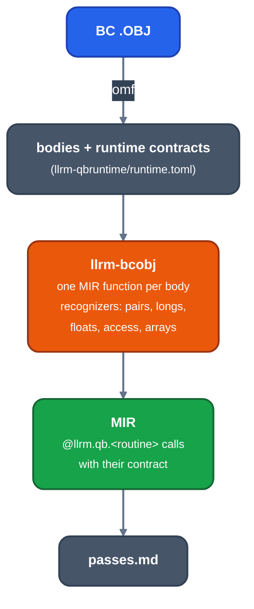

# Raising BC objects: arguments and numeric values

For contributors to the BC object path (`crates/frontends/bcobj`), which turns a Borland BASIC object into MIR before the ordinary optimizer runs. Explains how stack arguments become whole values, how runtime helpers become operations, and why a numeric argument is not an escaped address.

## Where it sits



*Where the raise sits*

Each body is raised by walking its nodes with a set of recognizers (`Recognizer` in [`sites.rs`](https://github.com/ali-mosavian/llrm/blob/c341bd6e3de058142c6652d399b8dfeb444eff9b/crates/target/llrm-x86-bc/src/sites.rs)); one that cannot express a function refuses it and says why. No optimization pass sees a register convention or a machine instruction: the raise emits values.

## Whole values from word pairs

BC passes and computes a long as two words. `pairs.rs` finds the pair of word operations on one long and `longs.rs` ([`longs.rs`](https://github.com/ali-mosavian/llrm/blob/c341bd6e3de058142c6652d399b8dfeb444eff9b/crates/target/llrm-x86-bc/src/longs.rs#L31)) emits one `i32` operation with the two words as the halves of its answer. `whole(low, high)` rejoins two words when they are known to be one value: both constants, a word and its sign (`ashr low, 15`, a `cwd`), or `trunc w` with `trunc (w >> 16)` of one `i32`. Reversed or duplicate halves, halves from separate pushes of different values, and halves with an observable intermediate are not joined; the pair stays two word operations.

```
 add ax,1 ; adc dx,0               %w = add i32 %v, 1
 (halves of one long)     ==>      DX = trunc (lshr %w, 16), AX = trunc %w
```

`Emitter::join` makes the long of a DX:AX answer the same way, through `whole` first and a zero-extend, shift and or otherwise, so a helper's two-register result is one value for `fold`, `gvn` and `dead`.

## Runtime helpers as operations

[`floats.rs`](https://github.com/ali-mosavian/llrm/blob/c341bd6e3de058142c6652d399b8dfeb444eff9b/crates/target/llrm-x86-bc/src/floats.rs) models the x87 stack as SSA `double` values and the float helpers as what they compute: `B$FILD` and `B$FIL2` are `sitofp`, `B$FIST` and `B$FIS2` are `llvm.lrint` (round to nearest, the x87 default) whose result halves are `trunc` and `lshr`. A value the x87 could hold exactly and a `double` cannot is refused. The helper's contract (cleanup, clobbers, memory it writes) comes from `runtime.toml`; a changed or unestablished contract is refused.

## Numeric arguments are values

`B$PEI2`, `B$PSI2`, `B$PEI4`, `B$PSI4` and `B$PER4` consume the integer or single bits pushed for them (their `cleanup` is 2 or 4 bytes); `llrm_qbruntime::numeric_print_argument` names them, and no pointer to the variable is among them. The raise pushes the loaded words, not the variable's address, so no object's address escapes through the call: `consts` can fold the value and `promote` can keep the variable in a register. A string or pointer argument is an address and escapes, as does any other routine's.

## See it

`llrm-omf` and the `llrm-bcdriver` crate drive the path; `crates/frontends/bcobj/tests/raise.rs` raises fixture objects and checks the printed answers. `--dump DIR` shows MIR after each pass.

Passes: [index](passes/readme.md), [fold](passes/fold.md), [gvn](passes/gvn.md).
