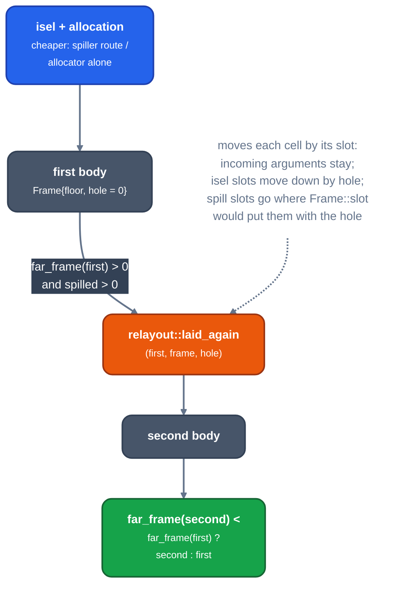

# The second frame

For contributors to the backend's frame layout. Explains why a function may be laid out twice and how the second layout is made without running the backend again.

## Why two layouts

A frame operand past `[bp-128]` needs a four-byte displacement. When a function has a spill area and such operands, `machined_once` ([`assemble.rs`](backend/assemble.md)) also tries a layout with a hole of `spilled` bytes above the allocas for the spill slots, and keeps whichever has fewer far operands (`far_frame`). No hole is tried when the target is basic, the frame is native, there are no spills, or nothing is far.

## How the second layout is made

*The second layout*

[`relayout.rs`](backend/relayout.md) works because every frame cell names the slot it lies in. It gives up, and the first layout stands, on bytes of inline code that name a displacement, a cell in no known slot, or call-private ranges it cannot move. Every pricing and encodability decision treats a frame cell as near, so the two layouts decide alike.

`LLRM_CHECK_FRAME=1` also runs the backend again with the hole and panics if the result differs from the relaid function.

## Not done

Readers that still take a concrete displacement (overlap tests, adjacency arithmetic, encoding sizes, debug homes) could take slot ids and offsets and leave the numbering to one finalisation pass. Today the layout is decided where each cell is made and moved by `relayout`.

See [the backend phases](backend/readme.md) around it.
