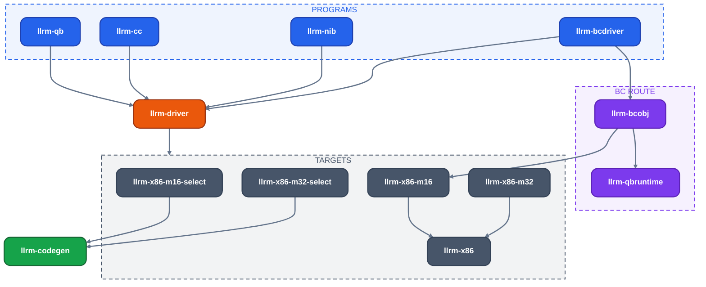
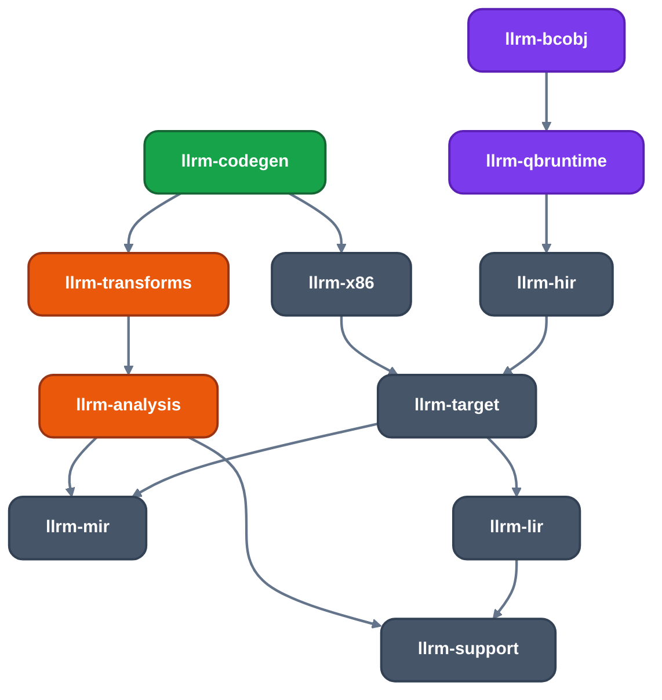
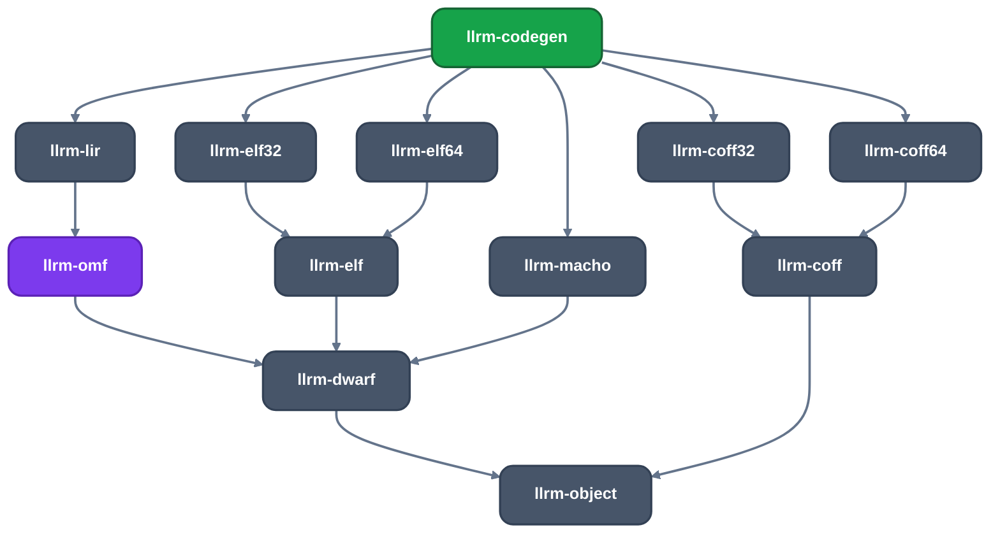

# Crates

Every crate in the workspace, by pipeline stage, and which depends on which. For contributors finding where code
lives; [source layout](../architecture/source-layout.md) says what sits inside `llrm-codegen`.

## Layering

The compiler is a pipeline: source frontend, HIR, MIR, optimizer, x86 backend, object writer. BC objects enter by a
small separate route (`llrm-bcdriver`).

```mermaid
%%{init: {'theme':'base','themeVariables':{'fontFamily':'Segoe UI, Helvetica Neue, Arial, DejaVu Sans, sans-serif','fontSize':'15px','primaryColor':'#475569','primaryTextColor':'#ffffff','primaryBorderColor':'#334155','lineColor':'#64748b','secondaryColor':'#475569','tertiaryColor':'transparent','clusterBkg':'transparent','clusterBorder':'#64748b','edgeLabelBackground':'#334155','textColor':'#64748b','titleColor':'#64748b'},'flowchart':{'curve':'basis','nodeSpacing':38,'rankSpacing':52,'padding':16,'wrappingWidth':360,'htmlLabels':true,'useMaxWidth':true}}}%%
flowchart LR
  classDef src fill:#2563eb,stroke:#1e40af,stroke-width:2px,color:#ffffff,rx:12px,ry:12px
  classDef mid fill:#475569,stroke:#334155,stroke-width:2px,color:#ffffff,rx:12px,ry:12px
  classDef opt fill:#ea580c,stroke:#9a3412,stroke-width:2px,color:#ffffff,rx:12px,ry:12px
  classDef out fill:#16a34a,stroke:#166534,stroke-width:2px,color:#ffffff,rx:12px,ry:12px
  classDef data fill:#7c3aed,stroke:#5b21b6,stroke-width:2px,color:#ffffff,rx:12px,ry:12px
  linkStyle default stroke:#64748b,stroke-width:2.2px
  src["<b>source</b><br/><small>qb, c, nib</small>"]:::src
  fe["<b>frontend</b><br/><small>llrm-qb, -c, -nib</small>"]:::src
  hir["<b>HIR</b>"]:::mid
  mir["<b>MIR</b>"]:::mid
  opt["<b>optimizer</b><br/><small>llrm-transforms</small>"]:::opt
  be["<b>backend</b><br/><small>llrm-codegen</small>"]:::out
  obj["<b>object</b><br/><small>llrm-omf, ...</small>"]:::data
  src --> fe
  fe --> hir
  hir --> mir
  mir --> opt
  opt --> be
  be --> obj
```

*The pipeline and the crate of each stage*

An arrow reads "depends on" (normal dependencies only; an edge implied by a path through other drawn crates is left out). `llrm-support`, `llrm-alloc`, `llrm-env` and `llrm-object` have no workspace dependencies; `llrm-mir` has only `llrm-env`.

*Programs, driver and targets*

*llrm-codegen and the representations*

*Object writers*

`llrm-codegen` names no `llrm-x86-m*` crate among its dependencies (`tests/core_depends_on_no_target.rs`). A target
reaches it only through `llrm-driver`, which is why `llrm-x86-m16-select` and `llrm-x86-m32-select`, written against
`llrm-codegen`, are separate crates beside their targets.

## Foundations

| Crate | Purpose |
|---|---|
| `llrm-env` | The one reader of an `LLRM_*` switch; no dependencies |
| `llrm-support` | Code shared by every crate: bit helpers, hashing, diagnostics, registers, a code page |
| `llrm-alloc` | The compilers' global allocator: a free list for each small size class over mimalloc; declared by the binaries only |
| `llrm-object` | The format-neutral object model: what the backend lays out and each writer writes |

## Intermediate representations

| Crate | Purpose |
|---|---|
| `llrm-hir` | The common HIR: model, codec, verifier, escape facts |
| `llrm-mir` | MIR: a subset of LLVM IR, with its text form, verifier, interpreter, datalayout, dominators, loops and scalar evolution |
| `llrm-lir` | The machine operand model: registers, memory operands, effects and selected semantics |

## Optimizer

| Crate | Purpose |
|---|---|
| `llrm-analysis` | Facts about MIR proved once for every pass: MemorySSA, alias and pointer facts, ranges, induction, call effects, liveness |
| `llrm-transforms` | MIR to MIR passes and the pipeline that runs them to a fixed point |

## Targets

| Crate | Purpose |
|---|---|
| `llrm-target` | What every target states: its platform description, read from TOML |
| `llrm-x86` | What every x86 target shares: the instruction forms |
| `llrm-x86-m16` | The 16-bit x86 target: instruction costs and the machine description |
| `llrm-x86-m32` | The flat 32-bit x86 target: its descriptions and its platform |
| `llrm-x86-m16-select`, `llrm-x86-m32-select` | Each target's instruction selector, peephole rules and effect rows, generated from its definition directory and written against `llrm-codegen` |
| `llrm-iselgen` | Build-time generator: instruction-selection patterns to a decision automaton and an emitter per pattern |
| `llrm-peepgen` | Build-time generator: peephole rules and the instruction table to a decision-automaton matcher |

See [targets](../machine/targets.md) for adding one.

## Backend

| Crate | Purpose |
|---|---|
| `llrm-codegen` | The compile driver, HIR to MIR emission, instruction selection, the machine phases (allocation, peephole, scheduling, jump layout), object writing and the HIR interpreter |
| `llrm-driver` | The one place that names targets: `-m16` and `-m32` pick one |

## Object formats

| Crate | Purpose |
|---|---|
| `llrm-omf` | OMF records, object modules and CodeView debug info |
| `llrm-coff` | The COFF container: sections, symbols and relocations for i386 and x86-64 |
| `llrm-coff32`, `llrm-coff64` | The COFF writer for i386, for x86-64 |
| `llrm-elf` | The ELF relocatable container, for a machine that names its relocation types |
| `llrm-elf32`, `llrm-elf64` | The ELF writer for i386, for x86-64 |
| `llrm-macho` | The Mach-O relocatable writer, for x86-64 |
| `llrm-dwarf` | The DWARF writer: `.debug_info`, `.debug_abbrev`, `.debug_line`, `.debug_str`, `.debug_aranges` |

See [the object model](../formats/object-model.md).

## Frontends

| Crate | Purpose |
|---|---|
| `llrm-qb` | The QuickBASIC-family frontend behind `llrm-qb` |
| `qbfront` | The QuickBASIC-family parser and semantic analysis, to HIR; its parser tables are generated at build time from `grammar/` by `crates/frontends/qb/crates/buildprs` |
| `llrm-qbruntime` | The QuickBASIC runtime's `B$` routine contracts, shared by `qbfront` and the BC frontend |
| `llrm-cc` | The C driver: clang as the front end, `llrm-llc` after it |
| `llrm-nib` | The Nib frontend behind `llrm-nib`, `llrm-run`, `nibfront` and `nib-lsp` |

## BC objects

| Crate | Purpose |
|---|---|
| `llrm-bcobj` | The BC object frontend: x86 decode into machine IR, blocks, extents, stack facts, per-site runtime contracts, and the lift of a BC object onto MIR |
| `llrm-bcdriver` | `llrm-omf`'s driver: BC objects raised, optimized, selected and written afresh |

See [BC objects](../frontends/bc.md).

## The workspace root

`llrm` (`src/bin`) holds the eight programs and depends on `llrm-codegen`, `llrm-mir`, `llrm-bcdriver`, `llrm-nib`,
`llrm-qb` and `llrm-cc`.
