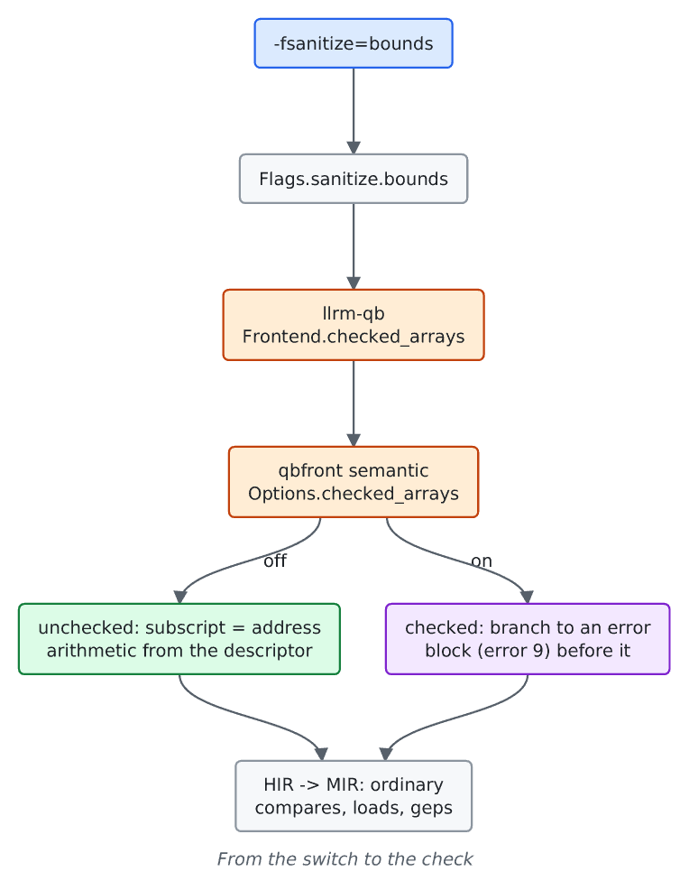

# Bounds checks

For users choosing check policy and for frontend authors. A subscript is checked only where the user asked.

## What the user selects

`-fsanitize=bounds` (or `-fsanitize=undefined`; `-fno-sanitize=bounds` turns it off) is the one switch, parsed with the other gcc options in [`flags.rs`](https://github.com/ali-mosavian/llrm/blob/c341bd6e3de058142c6652d399b8dfeb444eff9b/crates/backend/llrm-core/src/driver/flags.rs#L96). It is off by default. A frontend reads `Flags::sanitize.bounds` and marks its own semantics: `llrm-qb` sets `checked_arrays` ([`cli.rs`](https://github.com/ali-mosavian/llrm/blob/c341bd6e3de058142c6652d399b8dfeb444eff9b/crates/frontends/llrm-qb/src/cli.rs#L108)), which is BC's `/D` subscript check. The two other `/D` checks are separate switches ([integer-overflow-policy](integer-overflow-policy.md)).

## What the frontend emits

qbfront ([`bounds.rs`](https://github.com/ali-mosavian/llrm/blob/c341bd6e3de058142c6652d399b8dfeb444eff9b/crates/frontends/qbfront/src/semantic/bounds.rs)) reads a bound from the array descriptor. Where the procedure's own `DIM` or `REDIM` reached the read, the bound is what that statement handed the runtime: the frontend holds each array's rank and bounds in locals, so `promote` and `gvn` fold them, and drops them at `ERASE`, a `DIM`, a call that can reach the array, and any entry the runtime makes. `B$LBND` and `B$UBND` run only to raise "Subscript out of range": always for a dimension past the declared rank, and under `-fsanitize=bounds` where the array may be unallocated or the dimension outside its rank.

Because a check is an ordinary compare and branch in MIR, the optimizer treats it like any other: `ranges` removes it where the index interval proves it, and `unswitch`, `hoist` and `gvn` move or share it.

## Objects compiled by BC

A BC object compiled with `/D` or `/Ah` calls `B$HARY` for each element address. The raise ([`access.rs`](https://github.com/ali-mosavian/llrm/blob/c341bd6e3de058142c6652d399b8dfeb444eff9b/crates/target/llrm-x86-bc/src/access.rs)) keeps it a call, `@llrm.qb.B$HARY`, answering `{bx, es}`: computing the address in the raise would drop the check the program was compiled with, and a huge element is a 32-bit offset a 16-bit far index cannot hold. The routine's contract in `runtime.toml` says it reads any memory, writes its own, and raises an error, so `gvn` does not share two calls and `hoist` does not move them.

## Not selectable

Checks cannot be added to an object compiled without them: an access may already be inline machine code, and adding a check needs the array's identity, rank and extents.
