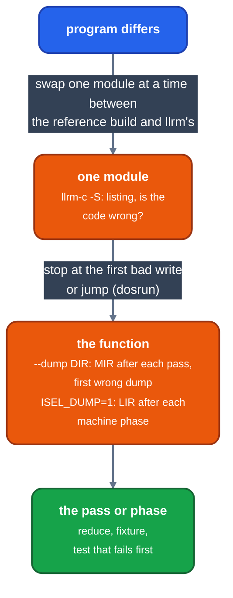
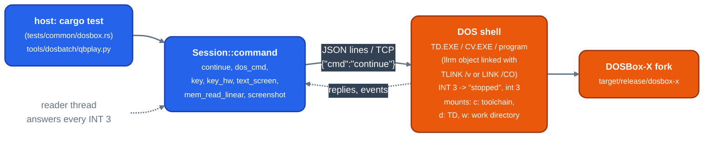

# Finding a miscompile in a DOS program

For contributors with a DOS program that behaves differently when built by llrm: narrow the fault to one module, stop the program where it goes wrong, then find the pass.

*From a differing program to the pass*

## 1. The runner: dosrun

The DOSBox-X the build bootstraps is the fork's `dosrun` branch (`toolchain/dosrunbuild.sh`, run by `build.rs` under the `dosrun` feature; `DOSBOX_BIN` names another). It boots once and runs each job, read from stdin, in a forked child. It streams JSON events to the file descriptor `DOSRUN_FD` names. A job is DOS command lines plus directives, ended by a line holding `.`:

    printf ':ms 60000\n:write C0000-C7FFF\nmount w %s\nw:\nPROG.EXE\n.\n' "$DIR" |
      DOSRUN_FD=3 SDL_VIDEODRIVER=dummy dosbox-x -nolog -conf job.conf 3>ev.txt >/dev/null 2>&1

`job.conf` is the program's usual conf with the `[autoexec]` section cut off and `core=normal`: the checks below run in the normal core only. `tools/dosbatch/dosbatch.py` builds jobs this way for every test that runs programs.

| Directive | Does |
|---|---|
| `:ms N` | Stops after N emulated milliseconds: `end` reason `limit`. A hang shows as `limit`. |
| `:write A[-B]` | Stops at the first write into linear A..B (hex, inclusive), before it lands. |
| `:nowatch` | Turns off the automatic stops. |
| `:keep` | On a clean exit, keeps the machine: later jobs fork from its state. |

The fork's source, `src/misc/dosrun.cpp`, is the reference for directives and events.

### Automatic stops

The normal core checks where execution lands and stops the job with a `crash` event at the first wrong place: unowned memory (a free block, an MCB header, video memory, past the MCB chain), the program's own data (as its debug info or `.MAP` classes it), empty memory (four bytes of `00` or `FF`), an unhandled #DE, #BR, #UD or #NM, and HLT with interrupts off. A jump through a bad pointer, a return to a wrecked address and a call through a corrupt vector all land in one of these.

### Reading a stop

A stop is followed by a `state` event with the registers and three views of how execution got there: `stack` (frames by return address still on the stack; wrong once the stack is overwritten), `calls` (the calls still open, from a ring of every transfer; what actually ran), and `bad_returns` (returns to an address no open call left; the first near the stop is usually the corruption). A `trace` event carries the ring. `end` gives the reason (`exit`, `crash`, `write`, `limit`, `wall`) and the executed instructions and memory operands.

A stop at an address that moves between runs is an interrupt, not the code under it: look at the ring for a "call" that drops SP by six bytes.

### Symbols

At load the fork reads the program's debug info (CodeView, TDINFO or Watcom info appended to the EXE, or a `.TDS` beside it) and, for an EXE, the `.MAP` beside it as a fallback. A `.MAP` gives publics only, so code in a static function reads as an offset into the public before it; name it from a listing (`llrm-c -S`). Build with `-g` for the full information.

## 2. Which module

Build the program entirely with the reference compiler, then replace one module at a time with llrm's. The oracle is the program's observable output (a frame, a log, a memory-write count). Run all single swaps, then bisect the ones that fail.

## 3. Where it goes wrong

Run the failing build under dosrun with a `:write` range over the damage, or `:ms` for a hang. The `write` or `crash` event gives the address and symbol, and `calls` the path to it. Compare registers with what the listing says the code should hold:

    llrm-c -S ... module.c -o module.obj

A bad segment (`lds`, `ss:` on data the program model places in DS) points at the machine model (`-m[no-]stack-is-data`), not a pass.

## Inline costs

`llrm-arm64-llc -debug-only=inline-cost f.ll` prints each inlining decision (`'callee' inlined into 'caller' with (cost=, threshold=)`) the callee's body as the costs were taken on it, and the cost of every instruction (`[inlinetrace]`), as LLVM's option of that name does; the pin's clang has none. The switches behind it are `LLRM_INLINE_REMARKS` and `LLRM_EXP_INLINETRACE`.

## 4. Which pass: dump and diff

Compile the one module with every stage dumped:

    llrm-c -O2 -I ... module.c -o module.obj --dump dump

`llrm-qb` and `llrm-nib` take `--dump` too; the variable `LLRM_MIR_STAGES=DIR` does the same for any driver. The directory must be on disk: a dump is thousands of small files, and the tools refuse a tmpfs such as `/tmp` or `/dev/shm` (it ran out of inodes once). The directory holds:

- `NN-<pass>.ll`: the module after each module-level pass, in order (`01-globalopt.ll`, `04-pipeline.ll`, `05-interprocedural.ll`, `12-lsr.ll`, ...);
- `NN/MMM-<stage>.ll`: inside the module pass `pipeline`, the module after each step of the per-function pipeline, numbered by run (`01/003-r01-gvn.ll`: run 1, round 1, gvn), with `pipeline.body` the function in question;
- `listing.asm` and `cost`: the final listing and the per-procedure executed estimate.

Diff two adjacent dumps. The first one that differs from what the source means is the pass:

    diff dump/01/003-r01-gvn.ll dump/01/004-r01-promote.ll

To confirm, turn the pass off and see the fault go: `-fno-PASS`, with gcc's names (`-fno-tree-pre`, `-fno-unroll-loops`, `-fno-strength-reduce`; an unknown name prints the list). Stage names in the dumps are those of [levels](../reference/levels.md). `LLRM_VERIFY=1` checks the module after each pass and each machine phase and names the first that breaks an invariant.

If the MIR is right to the last dump, the fault is in the machine phases:

    ISEL_DUMP=1 llrm-c -O2 -I ... module.c -o module.obj

prints the LIR after each machine phase (`=== PhiElimination`, `RegAlloc`, `ParallelCopy`, `Peephole`, `LoopSlots`, `Scheduler`, ...). The first phase whose output is wrong is the one.

`llrm-arm64-llc` (and `llrm-cc` with `LLRM_CC_TARGET=arm64-macos`) takes the same variable and prints the operations, one per line, after `Select`, `Prepass`, `FlagCse`, `StoreCluster`, `SibCall`, `OrderCopies` and `RegAlloc` (spills and reloads are visible there).

`llrm-mir FILE` reads, verifies and prints a `.ll` back; `llrm-mir --run [--entry NAME] [--fuel N] FILE` interprets its `@main`, so a reduced MIR program can be run before and after a pass.

## 5. The regression test

Reduce the module to the smallest source that still shows the fault, record the Watcom front end's output for it as the fixture's `.cgs`, and assert the symptom in the listing or the run. `tests/fixtures/c/nearviads.c` is one: near data read through SS, asserted by the absence of `ss:`, `lds` and `mov ds,` in the listing. Watch the test fail with the fix reverted.

## 6. The debug socket and debug symbols

Beside dosrun jobs, the fork has a debug socket for driving a DOS program or debugger interactively: set `DOSBOX_DEBUG_PORT=PORT` in the environment and the emulator listens on `127.0.0.1:PORT`. Commands and replies are one JSON object per line; replies come back in the order commands went out; events (`{"event":"stopped","int":3}`) arrive unprompted.

*The debug socket between the host and the DOSBox-X fork*

The commands the tests use:

| Command | Does |
|---|---|
| `continue` | resumes the emulator; the first one after start |
| `wait_for_shell` (`timeoutMs`), `status` (`shellReady`) | until DOS takes commands |
| `dos_cmd` (`command`) | runs a command line in the shell |
| `key` (`key`, or `scancode` and `ascii`) | a key through the BIOS buffer |
| `key_hw` (`key`) | a key through the keyboard controller, which a debugger that hooks IRQ 1 reads |
| `text_screen` | the screen's text and `video_mode` |
| `mem_read_linear` (`addr`, `len`) | memory as hex; `B8000` is the colour text page |
| `screenshot` (`path`, `timeout_ms`) | a PNG, written whole before the reply |
| `key_wait_arm` (`stop`) | the next keyboard read that finds nothing sends a `key_wait` event (`key` arms it too); with `stop` the guest is parked there until `continue` |
| `continue` (`ms`) | runs on; with `ms` the guest parks again after that many emulated milliseconds (`run_limit` event) |
| `screenshot` (`async`) | replies at once; a `screenshot` event follows the next frame, so a parked guest can be run on to draw it |
| `virtual_time_status` | `lockstep` is true in a fork that has the three above |

The socket stops the emulator at every INT 3, which debuggers use for their breakpoints; a reader thread must answer each `stopped` event with `continue`, or the program hangs. `tests/common/dosbox.rs` (`Session`) and `tools/dosbatch/qbplay.py` do it.

Lockstep: with `virtual time` on and the guest parked (`stop`, `ms`), the guest runs only between commands, so every key, look and screenshot is at an emulated instant that does not depend on the host. `tools/dosbatch/qbplay.py` (`Session(lockstep=True)`, `resume`, `run_until`, `keys_in_lockstep`, `snap`) drives it, and `qb32demos.py`, `test_qbgorilla.py`, `test_qbgfx.py` and `test_qbkeys.py` play in it. Nothing in them waits for a wall or CPU second: a step that takes too long fails after a stated number of emulated milliseconds, the same at any host load. The pictures, random parts included, are the same every run (`test_qbdemos_hostspeed.py`). A program that reads the keyboard without INT 16h (QB's SLEEP asks DOS) gives no park to stop at: settle on the picture (`qb32demos.settled`). A program that flushes the keyboard before it asks takes a key typed at the flush: `keys_in_lockstep(waiting=N)`.

How they are launched: `toolchain/dosrunbuild.sh` builds the fork at a pinned commit into `~/.cache/llrm` and links `target/<profile>/dosbox-x`; `build.rs` runs it for the `dosrun` feature. Rust tests use `common::dosbox::binary()`; the Python tools read `DOSBOX_BIN`, else that build, else `dosbox-x` on `PATH` (`tools/e2e/dosbox.py`, `tools/dosbatch/dosbatch.py`). Both write a conf with `core=normal`, mount the toolchain and work directories as drives and run with `SDL_VIDEODRIVER=dummy`.

### Symbols llrm emits

| Flag | Information | Read by |
|---|---|---|
| `-g`, `-gcodeview` | CodeView 4 in OMF (C) | Microsoft LINK `/CO` and CVPACK, CodeView (`tests/cv4.rs`) |
| `-gtd` | Turbo Debugger records, 16-bit OMF | `TLINK /v`, `TDUMP`, Turbo Debugger (`tests/turbo.rs`) |
| `-gdwarf` | DWARF | gdb, llvm-dwarfdump (`tests/dwarf.rs`) |

The debugger side is the fork. It reads CodeView 3 scalar types in BC-dialect images, DWARF module arrays, and follows near pointers through DS; its EXE loader no longer loads bytes after the image (fork #26-#29).

The records are described in [debug-info](../formats/debug-info.md) and [turbo-debugger](../formats/turbo-debugger.md). `tools/debug-matrix.py [--llrm DIR] [--only fe,bits]` prints, per frontend, width, object format and debug format, whether an independent reader finds the names, lines, parameters and locals of a known program (`tests/fixtures/matrix`).

### A session: break, read a local

The steps of `tests/turbo.rs`, on `tests/fixtures/dwarf/list.c`:

    llrm-c -m16 -gtd -O0 lst.c -o llst.obj

In DOS, with Turbo C++ as `c:`, Turbo Debugger as `d:` and the work directory as `w:`:

    tlink /v c:\lib\c0m llst.obj, llst.exe,, c:\lib\cm
    td llst.exe

Wait until `text_screen` shows `Module:`. F8 steps over and F7 into (`key` with `"key":"f8"`), until the second screen line reads `File: lst.c 9`. Ctrl-F7 (`scancode` 0x64, `ascii` 0) opens a watch; type the expression with `key`, then `enter`. The Watches window then reads `s int 0`, `n struct node * ds:00AE [_head]`, `*n struct node {ds:00AA,3}`, `n->v int 3`: the local, the parameter and what it points at, the same as for Turbo C++'s own build.

The debug gate runs these against the real tools: `. tools/debug-gate.env` sets `LLRM_REQUIRE_DWARF`, `LLRM_REQUIRE_TURBO`, `LLRM_REQUIRE_CODEVIEW`, `LLRM_REQUIRE_NIBRUN`, `LLRM_REQUIRE_JWLINK` and `LLRM_REQUIRE_WDUMP`, so a missing tool fails a test instead of skipping it, and `TCPP30_DIR`, `TD_DIR` and `VBDOS_DIR` locate Turbo C++, Turbo Debugger and the Microsoft tools. The gate steps are `turbo` and `cv4` ([gate](gate.md)).

## Reducing a failure: `tools/reduce.py`

`tools/reduce.py FILE --cmd 'COMMAND {}'` deletes lines (with `--unit blocks`, blank-line-separated blocks first: the functions of an IR file) while COMMAND keeps exiting 0 on the candidate (`{}` is its path), and writes `FILE.reduced`. It is one tool for C, Nib, BASIC and MIR text. COMMAND decides what "still fails" means, so it also decides that a candidate which no longer compiles is not interesting. Examples: a compiler panic, `! llrm-c -O2 {} -o /dev/null 2>&1 | grep -q 'widen.rs:142'`; a verifier error, `llrm-c ... 2>&1 | grep -q 'with no instruction choosing'`; a miscompile, a script that builds the candidate at the failing level and machine, runs it and compares with gcc's output (keep the candidate free of undefined behaviour, or it reduces to one). Every reproduced failure becomes a test at once, the smallest that still fails (`tests/run` for a program, a MIR text test for a pass): see [testing](testing.md).
