# Figures

For contributors who add a diagram to a document. A figure is a
short text spec in `docs/assets/figures/NAME.fig`; `--sync` draws it to `NAME.svg`
beside it, in the reader's light or dark setting. A document holds only the image,
so GitHub shows it with no build step.

## Adding a figure

1. Write the spec in `docs/assets/figures/NAME.fig`.
2. Reference the image from the document: ``,
   with the path relative to the document.
3. Run `python3 tools/docsbuild/build.py --sync` and commit the `.fig`, the `.svg` and
   the document.

To change a figure, edit its `.fig` and run `--sync` again. A spec written as a `fig`
fence in a document works too: `--sync` moves it to a `.fig` named after the document
(`docs-working-figures-1`) and leaves the image reference. An `.svg` with no `.fig` is
deleted.

`--check` exits 1, and the test `test_repository_is_in_sync` fails, when a generated file is
stale, a `fig` fence is left in a document, a `.fig` is referenced by no document, or an
image has no `.fig`.

The pass, analysis and backend pages in `docs/optimizations/reference/` are written
by `--sync` from the `//!` headers (extracted by `tools/passdocs.py`); edit the
header, not the page. A `fig` fence stays in the header: it becomes an image on those
pages, named after the crate and file (`llrm-analysis-cfg-1`), with no `.fig`.

## Writing a figure

A spec is the text of a `.fig` file, or the body of a `fig` fence in a Rust `//!`
header. The first line names the kind. Lines starting with `#` are comments.

```text
kind: graph | stack | lanes
title: caption under the figure, also the accessible title
```

A quoted string takes `\n` for a line break. A spec that does not parse fails
`--sync` with the line of the figure that is wrong.

### graph

Boxes and arrows, laid out in layers. Back edges become arcs around the drawing.

| Line | Meaning |
|---|---|
| `dir: down` or `dir: right` | Direction of flow, default `down` |
| `node ID "label" [fill=a..e] [shape=box\|round\|note]` | A node |
| `edge A -> B "label"` | An edge; `..>` is dashed, `==>` is bold; the label is optional |
| `group NAME "caption": ID ID ...` | A labelled container around the nodes |

The fills `a` to `e` are a fixed categorical palette; without `fill` a node is neutral.



Source: [docs-working-figures-1.fig](../assets/figures/docs-working-figures-1.fig)

### stack

A memory, stack or record layout, top to bottom as written.

| Line | Meaning |
|---|---|
| `cell "label" [off="bp+4"] [size="2"] [note="text"] [fill=a..e]` | A cell; the offset is on the left, the size inside the cell at its right, the note on the right |
| `gap "..."` | A cell that stands for omitted cells |
| `arrow "label" up\|down` | A growth direction |
| `bracket "label" from=N to=M` | Spans cells N to M, counting `cell` and `gap` lines from 1 |
| `scale: yes` | Cell heights follow `size` (8 pixels a unit, at most 160) |



Source: [docs-working-figures-2.fig](../assets/figures/docs-working-figures-2.fig)

### lanes

A timeline of lanes over numbered columns, or a call and return sequence.

| Line | Meaning |
|---|---|
| `lane ID "label"` | A lane, top to bottom in the order written |
| `tick N "label"` | Column N, with its label under the axis |
| `span LANE FROM TO "label" [kind=shared\|mut\|owner\|info]` | A bar over columns FROM to TO |
| `mark LANE N "label" [kind=error\|ok]` | A point in column N |
| `msg FROMLANE TOLANE N "label" [kind=call\|ret]` | An arrow between two lanes in column N; `ret` is dashed |



Source: [docs-working-figures-3.fig](../assets/figures/docs-working-figures-3.fig)
