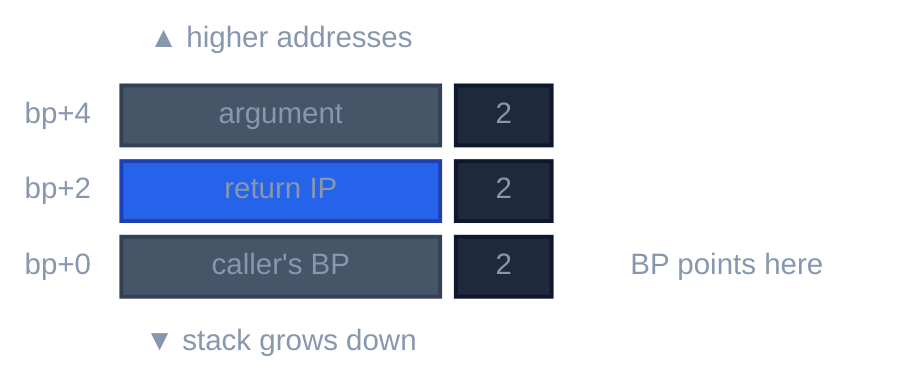
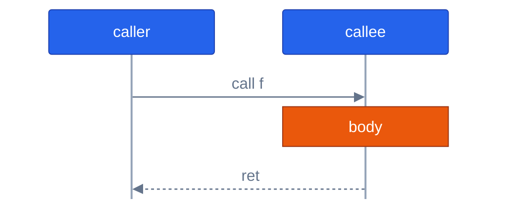

# Figures

For contributors who draw a diagram in a document or in a `//!` header. A figure is an inline
`mermaid` fence: GitHub draws it in its light and dark themes, so there is no image to build
or commit. Every figure uses one shared style, so a figure names a meaning, never a colour.

## The style

The style lives in one module, `tools/docs/docsbuild/tomermaid.py`. Nothing else spells a colour, and
this page names the constants rather than copying them.

- `INIT` is the first line of every flowchart: font, sizes, neutral line and caption colours
  that read on both themes, smooth edges. A block, gantt or sequence figure starts with its own
  init line, the entry of `INITS` for its type.
- `CLASSES` names the node classes. Write the class, not a fill:

| Class | Meaning |
|---|---|
| `src` | input, a front end, a source |
| `mid` | an ordinary stage or value |
| `opt` | the optimizer, the thing being explained |
| `out` | output, a written file |
| `data` | a table, a description, generated input |
| `warn` | refused, an error, a hazard |
| `note` | free text beside a figure, no box |

- A node label is a bold first line and small lines under it, written `<b>..</b> <small>..</small>`.
- A group is a `subgraph` tinted by `style` in the colour of what it holds (`TINT`): the commonest class
  of its nodes, grey for `mid`. A fan of three or more equal edges into one group ends at its border, so
  none crosses the caption.
- Number stages (①, ②) when the order matters. Put the title in an italic line under the fence, not in
  the diagram.
- Text in a label is escaped: `"`, `#`, `;`, `<`, `>`, braces and `|` as `#quot;`, `#35;`, `#59;`, `#lt;`,
  `#gt;`, `#123;`, `#125;`, `#124;`; a line break is ` `.

## Which diagram

| Draw | With |
|---|---|
| Stages, data flow, a decision, a layering | `flowchart` (`LR` or `TB`) |
| A memory, stack or record layout | `block-beta`: offset, cell, size, note in 8 columns |
| Lifetimes over a numbered axis | `gantt`: a lane is a section, a span a task, a point a milestone |
| Calls and returns between parties | `sequenceDiagram` |

A flowchart:

```mermaid
%%{init: {'theme':'base','themeVariables':{'fontFamily':'Segoe UI, Helvetica Neue, Arial, DejaVu Sans, sans-serif','fontSize':'15px','primaryColor':'#475569','primaryTextColor':'#ffffff','primaryBorderColor':'#334155','lineColor':'#64748b','secondaryColor':'#475569','tertiaryColor':'transparent','clusterBkg':'transparent','clusterBorder':'#64748b','edgeLabelBackground':'#334155','textColor':'#64748b','titleColor':'#64748b'},'flowchart':{'curve':'basis','nodeSpacing':38,'rankSpacing':52,'padding':16,'wrappingWidth':360,'htmlLabels':true,'useMaxWidth':true}}}%%
flowchart LR
  classDef src fill:#2563eb,stroke:#1e40af,stroke-width:2px,color:#ffffff,rx:12px,ry:12px
  classDef mid fill:#475569,stroke:#334155,stroke-width:2px,color:#ffffff,rx:12px,ry:12px
  classDef opt fill:#ea580c,stroke:#9a3412,stroke-width:2px,color:#ffffff,rx:12px,ry:12px
  classDef out fill:#16a34a,stroke:#166534,stroke-width:2px,color:#ffffff,rx:12px,ry:12px
  linkStyle default stroke:#64748b,stroke-width:2.2px
  fe["<b>Front end</b><br/><small>llrm-c</small>"]:::src
  mir["<b>MIR</b><br/><small>SSA</small>"]:::mid
  opt["<b>Optimizer</b><br/><small>llrm-transforms</small>"]:::opt
  obj["<b>Object file</b>"]:::out
  fe --> mir
  mir --> opt
  opt ==>|"lowering"| obj
```

*A front end, the optimizer and a written file*

A stack, with the offset on the left, the size at the cell's right and the note after it:

*A two-word frame*

A lifetime, one section per lane. The axis shows numbers; the tick labels go in the caption:

```mermaid
%%{init: {'theme':'base','themeVariables':{'fontFamily':'Segoe UI, Helvetica Neue, Arial, DejaVu Sans, sans-serif','fontSize':'15px','textColor':'#64748b','titleColor':'#64748b','gridColor':'#94a3b8','sectionBkgColor':'transparent','sectionBkgColor2':'transparent','altSectionBkgColor':'transparent','taskTextColor':'#ffffff','taskTextOutsideColor':'#64748b','taskTextLightColor':'#ffffff','taskTextDarkColor':'#ffffff','doneTaskBkgColor':'#16a34a','doneTaskBorderColor':'#166534','activeTaskBkgColor':'#2563eb','activeTaskBorderColor':'#1e40af','critBkgColor':'#dc2626','critBorderColor':'#991b1b','taskBkgColor':'#475569','taskBorderColor':'#334155','todayLineColor':'transparent'},'gantt':{'barHeight':34,'barGap':12,'topPadding':48,'leftPadding':150,'fontSize':14,'sectionFontSize':14,'numberSectionStyles':2}}}%%
gantt
  dateFormat X
  axisFormat %s
  tickInterval 1second
  section v (owner)
  owner :done, t8, 1, 3
  ✗ push is refused :milestone, crit, t10, 3, 3
  section r = &v[0]
  shared borrow :active, t9, 2, 3
```

*A borrow ends at its last use* Axis: 1 let; 2 borrow; 3 last use.

A call and its return:

*A call and its return*

## Checking a figure

`python3 tools/docs/docsbuild/build.py --check` lints every `mermaid` fence of a tracked Markdown file and of
a `//!` header, without mermaid: the first lines are the init line and a diagram type, quotes and brackets
balance, classes are defined, flowchart edges join declared nodes, a block row fits its `columns`, and no
label holds a raw `;`. It also rejects a legacy `fig` fence.

To see a figure, open the page on GitHub, or draw it locally with mermaid-cli: `mmdc -i fig.mmd -o fig.png`.
`build.py --check --render` draws every figure with the `mmdc` found through `$MMDC` or `PATH` (set
`PUPPETEER_CONFIG` for a puppeteer config) and fails on a parse error. It says so and skips when `mmdc` is
absent; the tests and CI never need it.

## Pass pages

The pass, analysis and backend pages in `docs/optimizations/passes/`, `analyses/` and `backend/` are
written by `python3 tools/docs/docsbuild/build.py --sync` from the `//!` headers, one page per file, with a
`readme.md` index in each; edit the header, not the page. A `mermaid` fence in a header is copied to the page
as it is. A rustdoc link such as `crate::cfg` becomes a link to the sibling page, or to the source on
GitHub when there is no page. Each page holds a digest of its header, of the tool and of what its own links
resolve to (adding a source file changes only the pages that link its name, and its own page and index); `--sync` rewrites only a page whose digest changed and deletes the page of a removed file, and
`--check` fails when a page is stale.

## Converting older figures

A figure was once a short text spec (`kind: graph|stack|lanes`) drawn to a PNG. `tools/docs/docsbuild/mdfigs.py
--convert` turns the image of such a figure, or a `fig` fence, into a `mermaid` fence and an italic caption,
and `--headers FILE...` does the same for the `//!` headers of Rust files. `tomermaid.convert` is the
converter; read it for the spec language.
