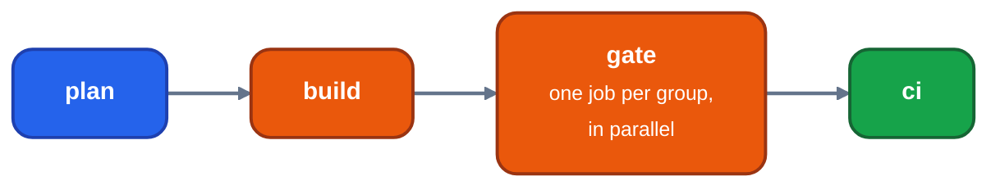
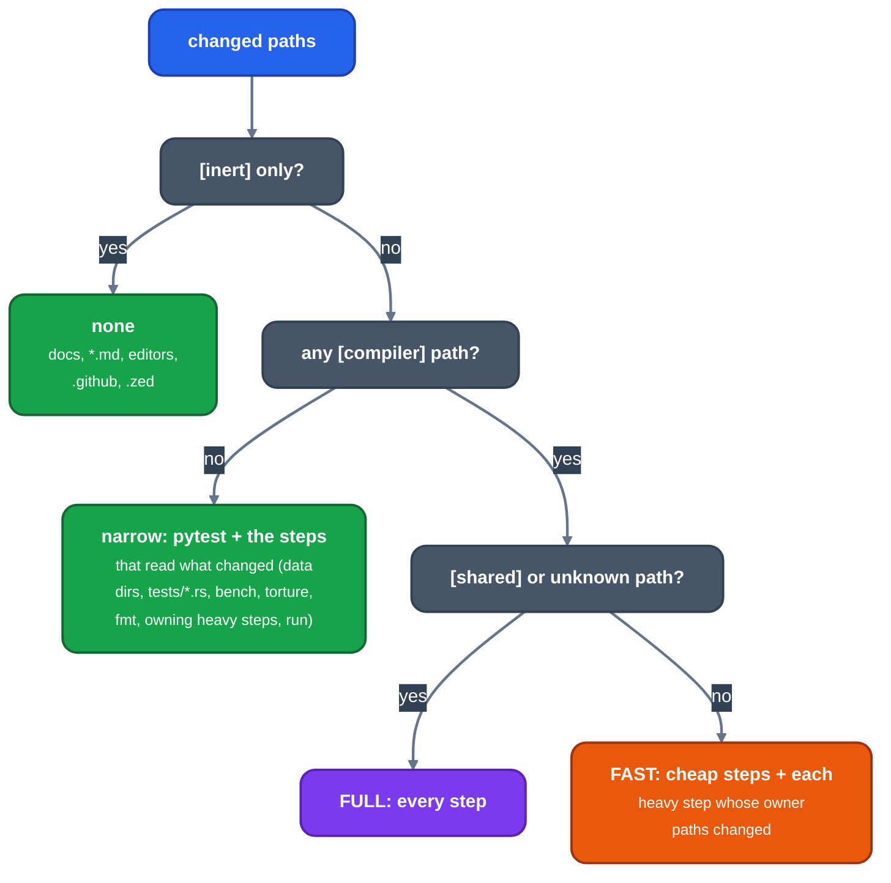

# The gate

For contributors: what runs on a pull request, which paths select which steps, what each step must pass, and how to run the same thing locally. [testing](testing.md) covers running one narrow test.

The gate is `tools/gate/gate.py`; `tools/gate/tiers.toml` is the only table that ties a path to a test.

## What happens on a pull request

`.github/workflows/ci.yml` runs on every pull request, on pushes to main and on `workflow_dispatch`; a new push to a pull request cancels its running one.

*The jobs of a pull request*

| Job | Does | Passes when |
|---|---|---|
| `plan` | `gate.py plan --json --base HEAD^1`: the tier, the job groups with something to run, the steps skipped on this host | it prints a plan; the plan is also in the step summary |
| `build` | `gate.py run --group build`: the build step once; the target directory is handed on as an artifact | the build step passes. Skipped when the plan has no steps |
| `gate` | one job per group in `[groups]`, each `gate.py run --group G` on the shared target directory; `fail-fast` is off | every step of the group passes or is skipped. Logs are uploaded as `logs-G` |
| `ci` | one status for the run | plan succeeded, build did not fail, no gate job failed or was cancelled |

`GATE_ALLOW_MISSING=1` is set by the workflow only: a step whose tool is not on the runner (Turbo C++, CodeView, QCport's Borland C, QuickBASIC, `perf`) is SKIPPED with the reason instead of failing, and so are the run languages and test binaries that need one. Hosted runners have no instruction counters, so `measure` and the counter-reading tests are skipped.

CI is a status; it is not a required check, so no merge waits for it. Every step a merge is expected to pass is the same step `gate.py run` runs locally.

Caches (the forks `~/.cache/llrm`, the workspace `target`, the cargo registry, `tools/uv.lock`) and `tools/ci/restore_mtime.py`, which gives files their commit times so cargo rebuilds only what changed, are described in the workflow's header. `tools/ci/nib_lsp_paths.py --write` regenerates the path list of `.github/workflows/nib-lsp-release.yml`, which builds `nib-lsp` on tags `nib-lsp-v*` and checks it on main.

## Tiers

*How the changed paths select the tier*

`[compiler]` is `crates/**`, `src/**`, `build.rs`, the manifests, `rust-toolchain.toml`, `.cargo/**`. `[shared]` is the manifests, `src/**`, `tests/common/**`, `crates/ir/**`, `crates/support/**`, `crates/target/llrm-target/**`, `crates/mc/llrm-object/**` and `tools/gate/**`. A path in no table is unknown and selects full. Backend and transform changes are not shared: they take fast plus every codegen heavy step (`run`, `qcport`, `pytest-programs`).

`gate.py plan [--base REF] [--files F...] [--tier auto|fast|full]` prints the tier, the reason, the steps and the run languages. A diff that changes only some crates tests those crates and the crates that depend on them (and the `[[reads]]` crates whose tests read their sources); full tests the workspace.

`gate.py main` is the scheduled run: the full tier over `origin/main` once 5 merges or 2 hours have passed since the last green, a creep check of the compile cost, and a bisect over the first-parent commits when it goes red. It needs a tree and `CARGO_TARGET_DIR` of its own.

## Steps

Every step exits 0 to pass, 77 when SKIPPED, and anything else to fail. A cargo test step also fails as INCOMPLETE (78) when fewer test binaries reported than were selected, or its filter matched no test: a cut run prints fewer results, not failures.

| Step | Runs | Passes when | Group |
|---|---|---|---|
| `build` | `cargo check --workspace --all-targets`, the same with `--release`, then `cargo test --release --workspace --no-run`, all with `RUSTFLAGS=-D warnings` | it compiles with no warning | build |
| `lib` | `cargo test --release --lib`, in random order (`LLRM_SHUFFLE_SEED=N` repeats one) | all unit tests pass | unit |
| `doc` | doctests, only if a doc comment has a fence | they pass | unit |
| `crate-tests` | each selected crate's `tests/*.rs` | pass | unit |
| `scans` | the `[[scan]]` source-text ratchets | each passes (all run; the first red does not hide the others) | unit |
| `fmt` | `tools/fmt.sh --check` (when a `.rs`, `rustfmt.toml` or the formatter changed, or full) | no file would change and no comment past column 80 stays | unit |
| `rfmt-post` | the formatter's own tests | pass | unit |
| `integration` | every root `tests/*.rs` binary but the whole/exclusive ones, `timing` and the split filters | pass | integration |
| `build-script-reruns` | `--test build_script_reruns`, alone after the others | the working tree is unchanged by the build | integration |
| `run` | `tests/run` in DOSBox for the languages the diff touches (`LLRM_RUN_ONLY`) | every program prints its `.out` | run |
| `pytest` | `tools`, `crates`, `tests/*.py` | pass | python |
| `pytest-programs` | `tests/test_programs_compile.py`, `tests/test_loops.py` | every program compiles bar `tools/sizes-known.txt`; loop checks hold | python |
| `bench` | `tools/bench/bench.py` | its last line says `0 problems`: no count of the compiler's own above the base's (`BASE` line; the base is the merge-base with origin/main, built and measured by its own tree), none of a reference off its stored count | tools |
| `torture` | `tools/torture/torture.py --gate`, the fixed sample | each program is a pass or a named design difference | tools |
| `identity` | `tests/toolchain.rs` `test_the_identity_gate_passes` | the compiler built against itself makes identical objects | identity |
| `turbo` | Turbo Debugger sessions (`tests/turbo.rs`) | the debugger shows the same values | reference |
| `cv4` | Microsoft LINK and CodeView sessions (`tests/cv4.rs`) | pass | reference |
| `qcport` | `tools/qcport-run-cc.py` | QCport built by llrm-cc draws what the Borland build draws | reference |
| `dos-slow` | `tools/dosbatch` tests marked `slow_dos` | pass | dos |
| `measure` | `tools/measure.py check` | no compile-cost or growth rise past `[measure]` | cost |

`turbo`, `cv4`, `identity`, `pytest-programs`, `dos-slow`, `qcport`, `rfmt-post` and `measure` are heavy: the fast tier runs one only when a path in its `owners` changed. The rest are cheap and run in every tier that has code. Python tests declare a tool they need with `REQUIRES = [...]` at module level and are dropped by name where it is missing.

The `pytest` step runs one pytest process per test file, `PYTEST_SHARDS` at a time, longest first by the times of the last green run (`tools/gate/pytest_shards.py`). It fails when any file fails, and when the tests reported are fewer than the tests collected.

`dos-slow` goes through the same sharder (`-m slow_dos`, times in `$CARGO_TARGET_DIR/dos-durations.json`): its graphics probes are dealt over processes, each building only the probes it runs.

Clippy is not run. `-D warnings` in the `build` step keeps the tree free of compiler warnings.

Cost, as `tiers.toml` states it: `turbo` 48 s, `cv4` 30 s, `identity` 96 s, `pytest-programs` 60 s, `qcport` 100 s, `rfmt-post` 40 s cold, `dos-slow` 5 to 8 minutes, `measure` 3 to 8 minutes when its base is not yet measured. The budgets are 5 minutes for fast and 10 for full on the loaded host. Steps run `JOBS` at a time (default half the cores, at least 4), longest first, so the wall is about the longest step. [testing](testing.md) describes the steps' tools; [compile time](measurement/compile-time.md) describes `measure`.

## The smoke tier

`gate.py run --tier smoke [--pr N]` is the cheap check of one PR (about a minute on a warm target): the fast tier's plan cut to `build`, `lib`, `crate-tests`, `scans`, `facts` (the target-facts audit), `products` (no tracked `.o`, `.obj`, `.exe`, `.map` or `.lst` outside the fixtures; no build), `fmt`, `docs` (generated pages and pass pages current), `pytest-programs` (every program compiles; with the build), `pytest-quick` (the pytest step's files but the slow ones named in `tiers.toml` `[smoke] slow_pytest`; with the build) and `changed-tests` (the test files the diff touches or sits beside). It refuses first, exit 2: a dirty tree, a PR whose base is not `main` (stacked; `--pr` reads it from `gh`), a branch that conflicts with `origin/main`, and a commit message, PR text or added line that names the assistant or its maker. A smoke PASS is not a merge licence: only a full gate on the tip is.

## Running it locally

    export CARGO_TARGET_DIR=/path/to/target
    python3 tools/gate/gate.py plan
    JOBS=6 python3 tools/gate/gate.py run
    python3 tools/gate/gate.py run --steps lib integration
    python3 tools/gate/gate.py run --tier full --expect SHA

`run` re-executes itself in its own systemd user scope with `CPUWeight=1000` (`GATE_CPU_WEIGHT`, `0` to turn off), so session builds sharing one scope do not starve it. `run` refuses a tree that differs from `HEAD` in tracked files (`--allow-dirty` runs it and says so), and `--expect SHA` refuses unless `HEAD` starts with SHA, so a pass names the commit that ran. To gate a commit while you keep working, check it out detached in a worktree of its own with its own `CARGO_TARGET_DIR`; building or switching in a tree a gate is using breaks it.

Output is one `[time] STEP ok|FAIL|SKIPPED|INCOMPLETE` line per step, what each failing test printed, a per-step CPU table, and a last line `GATE TIER PASS|FAIL: steps at SHA in Ns`. Read the last line at the commit you meant. Logs are `$CARGO_TARGET_DIR/gate-logs/STEP.log`, and `STEP.failed.log` for a step that failed. A step that prints nothing and uses no CPU for `GATE_STALL_MINUTES` (default 10) is killed.

A step that neither writes to its log nor uses CPU anywhere in its process tree for `GATE_STALL_MINUTES` (10) is killed and ends with the reason at the end of its log. A pytest test over its CPU limit fails with its name and its subprocess is killed (`tools/gate/pytest_cpulimit.py`).

`gate.py bisect GOOD BAD STEP...` finds the first first-parent commit where the steps fail.

## What must pass

| Area | Tests |
|---|---|
| Rust code | `lib`, `doc`, `crate-tests`, `integration`, `scans`; no compiler warning; `fmt` |
| Programs on DOS | `run` (tests/run, examples), `bench` baselines, `tests/test_programs_compile.py`, `tools/dosbatch` tests |
| Differential | `tests/differential.rs` inside `integration`: llrm-qb against BC, and the conformance cases |
| Code unchanged | `identity`; `bench` counts that only ratchet |
| Debug information | `tests/dwarf.rs` inside `integration`, `turbo`, `cv4` |
| Large programs | `qcport`, `torture` |
| Python tools | `pytest` |
| Compile cost | `measure` |

A run language, test binary or step whose tool is missing locally is skipped by name, never passed.

## Before a push

`tools/prepush.sh` runs the gate's cheap, tree-reading steps (tiers.toml `[prepush]`: `fmt`, `docs`, `products`, `scans`, `facts`, and the `docs_links` test) and prints `PREPUSH PASS` or `PREPUSH FAIL: <steps>` first. A scan added to `[[scan]]` is picked up by the next run. It does not run the build, the tests, the benches, the oracle sweep, perf or cost.
