# Compile time

For maintainers: how to measure what the compiler costs, per level and per pass, and what to read the result against. No figure is kept here; each tool below prints its own.

## The map

`tools/compile_map.py` ranks llrm's compile of one file by step, names each step's owner, flags a step of 2% or more with none, and sets the categories beside gcc's and clang's (`-ftime-report`, `-ftime-trace`). The rows are checked against the `perf` total, and `--diff` against a saved `--json` shows what a merge moved. Its header names the commit and the command lines, so that two maps made under other flags are not compared.

## Unit

User instructions retired (`perf stat -e instructions:u`, children included), one process per compile, source to object. A count of work done, so a loaded host does not move it. Each tool exits 77 where perf cannot count. Address-space randomisation moves a count, so the measured command runs under `setarch -R`.

```mermaid
%%{init: {'theme':'base','themeVariables':{'fontFamily':'Segoe UI, Helvetica Neue, Arial, DejaVu Sans, sans-serif','fontSize':'15px','primaryColor':'#475569','primaryTextColor':'#ffffff','primaryBorderColor':'#334155','lineColor':'#64748b','secondaryColor':'#475569','tertiaryColor':'transparent','clusterBkg':'transparent','clusterBorder':'#64748b','edgeLabelBackground':'#334155','textColor':'#64748b','titleColor':'#64748b'},'flowchart':{'curve':'basis','nodeSpacing':38,'rankSpacing':52,'padding':16,'wrappingWidth':360,'htmlLabels':true,'useMaxWidth':true}}}%%
flowchart LR
  classDef src fill:#2563eb,stroke:#1e40af,stroke-width:2px,color:#ffffff,rx:12px,ry:12px
  classDef mid fill:#475569,stroke:#334155,stroke-width:2px,color:#ffffff,rx:12px,ry:12px
  classDef opt fill:#ea580c,stroke:#9a3412,stroke-width:2px,color:#ffffff,rx:12px,ry:12px
  classDef out fill:#16a34a,stroke:#166534,stroke-width:2px,color:#ffffff,rx:12px,ry:12px
  linkStyle default stroke:#64748b,stroke-width:2.2px
  src["<b>source</b>"]:::src
  subgraph g_one["LLRM-C: ONE PROCESS, ONE PERF COUNT"]
    llrm["<b>llrm-c</b>"]:::opt
    hir["<b>HIR</b>"]:::mid
    mir["<b>MIR passes</b>"]:::mid
    isel["<b>isel</b>"]:::mid
    ra["<b>regalloc</b>"]:::mid
  end
  omf["<b>OMF</b>"]:::out
  src --> llrm
  llrm --> hir
  hir --> mir
  mir --> isel
  isel --> ra
  ra --> omf
  style g_one fill:#47556912,stroke:#475569,stroke-width:1.6px,stroke-dasharray:7 5,color:#475569
```

*What one count covers*

`gcc -c` is the driver, `cc1` and `as`; `clang -c` is the driver and `cc1` with its integrated assembler.

## Instruments

| Question | Command |
|---|---|
| What does a branch cost against its merge-base? | `tools/measure.py check` (also `record`, `show`, `creep`) |
| Instructions per file at -O1, -O2, -O3, -Os | `tools/compile-cost.py [--noise] [llrm-c]` |
| Which step is the biggest overall? | `tools/pass-profile.py [--level -O2] [--top N]` |
| How often does each body go through the pipeline, and how much of it changes nothing? | `tools/pipeline-runs.py [--level -O2] [--group qcport\|programs]` |
| llrm against gcc and clang at every level | `uv run --project tools python crates/target/llrm-x86-m32/vsgcc/levels_time.py [--runs 3] [--extra DIR]` |
| How does the cost grow with program size? | `vsgcc/scaling.py run`, then `report` (`vsgcc/scaling_gate.py` is the gated form) |

`tools/compile-cost.py` measures the 66 vsgcc programs and, with `QCPORT` and `QCPORT_INC` set, QCport's modules. `tools/measure.py` measures `dist` builds (see testing.md) and stores a measurement per tree (so the commit that lands a gated head finds the head's measurement) under `LLRM_MEASURE_DIR` (default: `llrm/measure` in the user cache directory), builds the merge-base when it has none, and fails on a rise past the tolerances in `tools/gate/tiers.toml` `[measure]`. It has three parts: the compile of the programs, the quadratic term of the cost at N/2, N and 2N on generated programs (`vsgcc/scaling_gate.py`), nil for fixed and linear work (a rise of it fails only where the cost at 2N did not fall: removing a cost that weighs more at N than at 2N raises the term while it lowers every point), and the same term for each step. Every generator of `vsgcc/scaling.py` is an axis of the scaling gate (a test says so), at the largest N whose 2N compile costs about 12 G instructions at -O2. A step whose cost at 2N rose 1.5x and 20 Minstr fails whatever its share of the compile (`step_rise`, `step_floor`); steps from 5 Minstr are recorded, so a small step that grows is seen to rise. mimalloc's heap layout moves a step's count with no change in its work (#1755: +27 Minstr, equal under glibc), so a step rise stands only if the same step also rose in `llrm-c` built with `--features system-alloc`; that build is made, and the cells measured, only for a flagged step, and stored per tree. The compile is judged on the shipped binary, and an axis less the steps dropped that way (their rise is not one; #1991: `unrolled Os mir lsr` 117 -> 169 M under mimalloc, 149 M under both under the system allocator, failed the axis it is part of); what is left of the axis is judged as before. `tools/compile-cost.py --noise` measures twice and prints the spread the tolerances come from.

`levels_time.py` prints a table of llrm over gcc and over clang per level, with the instructions of an empty file as the start-up cost every ratio includes. `vsgcc/scaling.py` compares the three compilers on generated programs whose size doubles. See [comparison](../../comparison/readme.md) for the code-quality side of the same comparison.

## Inside one compile

| Switch | Prints |
|---|---|
| `LLRM_DEBUG=time` | each step's own and total instructions (`[instr]` rows), by pass name as [levels](../../reference/levels.md) lists them |
| `LLRM_DEBUG=runs` | per body: fixed points, rounds, pass runs; a pass's own work apart from the analyses it computed first, and the runs that changed nothing |
| `LLRM_WHY` | every analysis computed again, and the pass that invalidated it |
| `LLRM_CHECK_*` | a check that a cached or incremental result equals a fresh one (`LLRM_CHECK_STALE`, `LLRM_CHECK_INTERVALS`, `LLRM_CHECK_REPLAY`, ...); each is a lookup in a snapshot of the environment, not a `getenv` |

A flag (`LLRM_WHY`, `LLRM_CHECK_*`, `LLRM_VERIFY`, `LLRM_BLESS`) is off when unset, empty, `0`, `false` or `off`, and on for any other value; one parser reads them all (`llrm_env`, asked through `llrm_support::env_set`). Unset a flag to turn it off. Variables that carry a value (`LLRM_DEBUG`, `LLRM_TIME_TOP`, `LLRM_MIR_STAGES`, `LLRM_CANDIDATES`) are read as their own.

A change that saves compile time is checked byte-identical on the programs with its `LLRM_CHECK_*` switch on, so a faster compile is not a different one.

## Reading a result

- Own instructions exclude children; total includes them. The biggest own step of the whole set, not of one file, is the target: one file (`d_faces`) is a tenth of QCport and unlike the rest.
- A function's cost grows superlinearly in a few passes; the scaling axes (loop nest depth, caller chain length, function size) find them, and `tools/measure.py` gates their quadratic term.
- The spiller route and the allocator's search run the machine phases more than once per function; whether they run is a level setting ([levels](../../reference/levels.md#register-allocation-by-level-gccs-ira-against-ours)).
- The pass manager skips an analysis a pass declares it does not read (`Depends`) and freezes the module summaries after the interprocedural step; a pass that adds a memory operation after that point reads stale summaries, which `LLRM_CHECK_STALE` catches. The module analyses of one segment are carried to the next ([module-analyses](../../optimizations/module-analyses.md#between-segments-and-after-the-summaries-are-made)).

## Designs not taken

- Stable instruction identity (slot indexes in the manner of LLVM's `SlotIndexes`) for the allocator: not pursued, because the spiller path is a few percent of a compile; copy-on-write instruction lists moved the cost to the next scan of the body instead of removing it ([#990](https://github.com/ali-mosavian/llrm/issues/990), [#997](https://github.com/ali-mosavian/llrm/issues/997), [#999](https://github.com/ali-mosavian/llrm/issues/999)).
- A memo of alias pairs keyed by content costs more than it saves; one per `Accesses` needs ids stable across states ([#1167](https://github.com/ali-mosavian/llrm/issues/1167)).

## Open

- [#1166](https://github.com/ali-mosavian/llrm/issues/1166) per-call incremental call-effects and points-to.
- [#1168](https://github.com/ali-mosavian/llrm/issues/1168) `consts::cells` clones its maps in the fixed point.
- [#1169](https://github.com/ali-mosavian/llrm/issues/1169) `_pointer_stores` builds a MemorySSA per memory solve.
- [#1170](https://github.com/ali-mosavian/llrm/issues/1170) the interprocedural rerun loop iterates inline rounds.
- [#1105](https://github.com/ali-mosavian/llrm/issues/1105) fixed-point loops not yet on the dataflow solver.
- [#1088](https://github.com/ali-mosavian/llrm/issues/1088) the spiller route runs the machine phases twice.
- [#1110](https://github.com/ali-mosavian/llrm/issues/1110) loop passes cost O(depth^2).
- [#1229](https://github.com/ali-mosavian/llrm/issues/1229) the allocator's spill, facts and interval steps are superlinear: the rows of `branches`, `chain` and `live` ([vsgcc/scaling.md](../../../crates/target/llrm-x86-m32/vsgcc/scaling.md#known-remaining-superlinear)).
