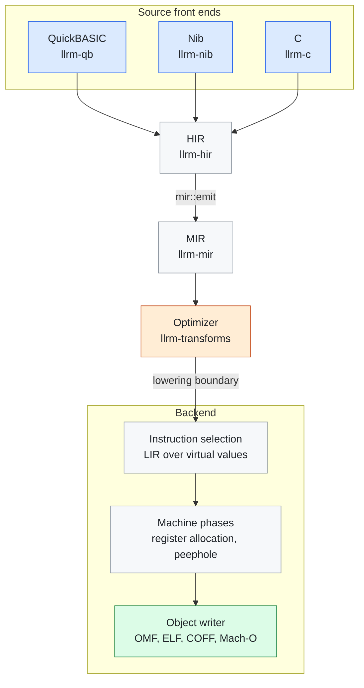
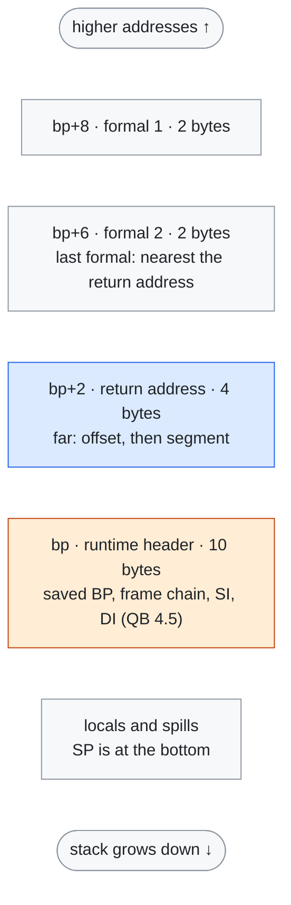
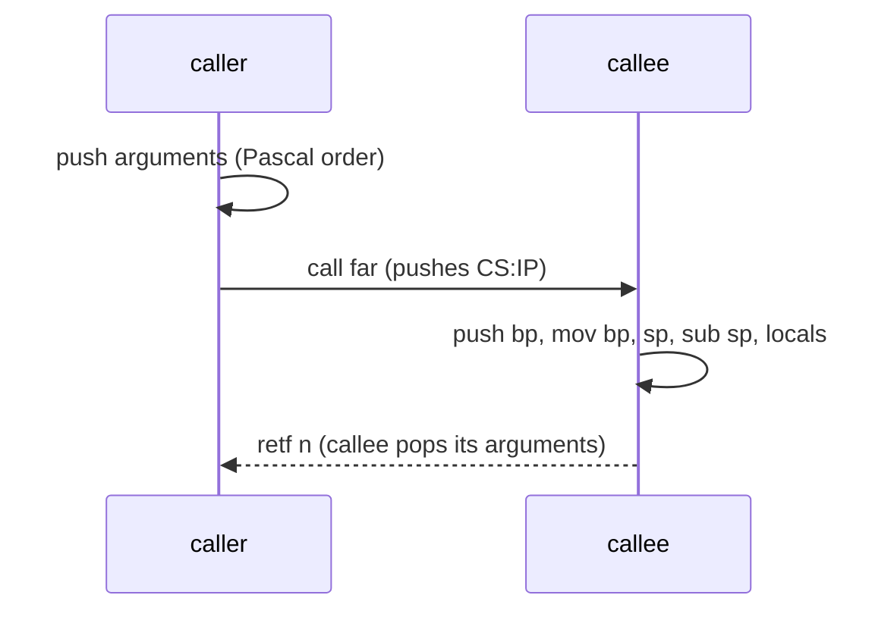

# Mermaid figures: trial

Audience: the maintainers choosing how docs draw figures. GitHub renders a `mermaid` fence in markdown, sized to the page, in its light and dark themes, with no generated file. This page draws four of our figures that way, with styling by classes. Compare with the generated PNG figures in #1546.

## Pipeline (graph with groups)

## Frame of a QuickBASIC procedure (stack layout)

## Borrow timeline (spans over source lines)

```mermaid
gantt
  title A change while a shared borrow is used later
  dateFormat X
  axisFormat %s
  section v (owner)
  owner of v :done, v, 1, 9
  section r = &v[0]
  shared borrow, live to its last use :active, r, 3, 9
  v.push(3) is refused :crit, c, 6, 7
```

Lines: 1 `let mut v`, 3 `let r = &v[0]`, 6 `v.push(3)`, 9 `print(r)`.

## Call and return (sequence)

