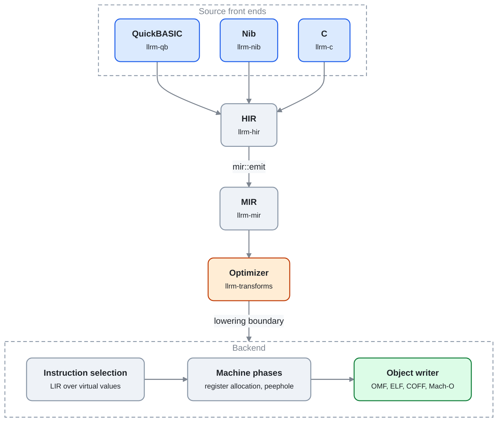
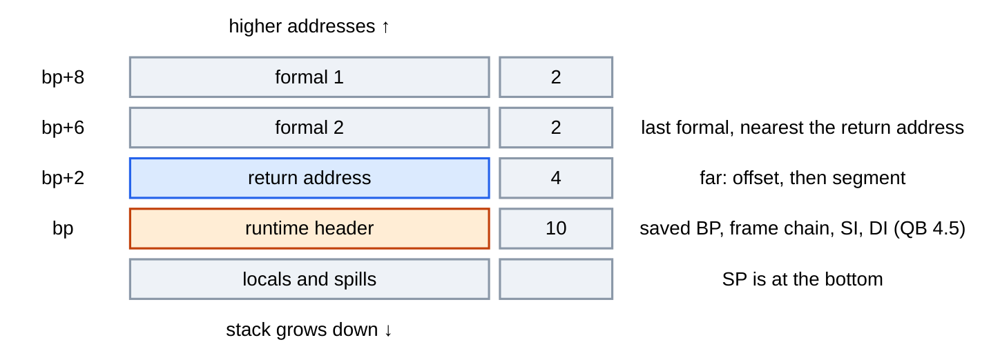
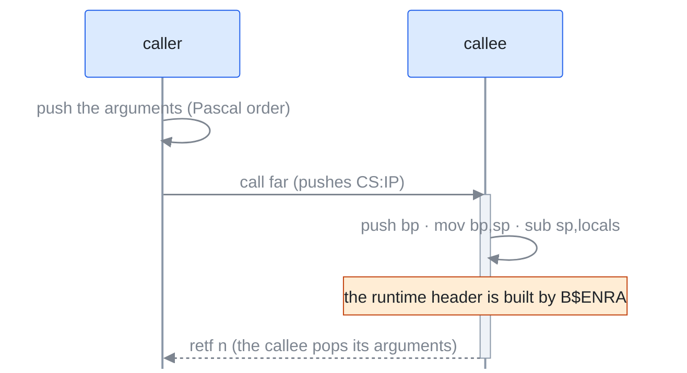

# Mermaid figures: trial

Audience: the maintainers choosing how docs draw figures. GitHub renders a `mermaid` fence in markdown, sized to the page, in its light and dark themes, with no generated file. This page draws our figures that way with one shared style; compare with the generated PNG figures in #1546.

## Style

Every figure starts with the same `init` line (font, sizes, neutral colours that read on the light and the dark theme, transparent group and label backgrounds, smooth edges) and the same classes, so a figure only names meaning, never colour:

| Class | Meaning | Fill |
|---|---|---|
| `src` | input, a front end, a source | blue |
| `mid` | an ordinary stage or value | grey |
| `opt` | the optimizer, the thing being explained | orange |
| `out` | output, a written file | green |
| `data` | a table, a description, generated input | purple |
| `warn` | refused, an error, a hazard | red |
| `note` | free text beside a figure, no box | none |

## Pipeline

*From source to object file.*

## Frame of a QuickBASIC procedure

*Pushed by the caller: the formals and the return address. B$ENRA builds the header.*

## Borrow timeline

```mermaid
%%{init: {'theme':'base','themeVariables':{'fontFamily':'Segoe UI, Helvetica Neue, Arial, DejaVu Sans, sans-serif','fontSize':'14px','textColor':'#7d8590','titleColor':'#7d8590','gridColor':'#8b98a8','sectionBkgColor':'transparent','sectionBkgColor2':'transparent','altSectionBkgColor':'transparent','taskTextColor':'#1f2328','taskTextOutsideColor':'#7d8590','taskTextDarkColor':'#1f2328','doneTaskBkgColor':'#dcfce7','doneTaskBorderColor':'#15803d','activeTaskBkgColor':'#dbeafe','activeTaskBorderColor':'#2563eb','critBkgColor':'#fee2e2','critBorderColor':'#b91c1c','todayLineColor':'transparent'},'gantt':{'barHeight':30,'barGap':10,'topPadding':44,'leftPadding':150,'fontSize':13,'sectionFontSize':13,'numberSectionStyles':2}}}%%
gantt
  dateFormat X
  axisFormat %s
  tickInterval 1
  section v (owner)
  owner of v                        :done, v, 1, 9
  section r = &v[0]
  shared borrow, live to its last use :active, r, 3, 9
  v.push(3) is refused              :crit, c, 6, 7
```

*Line numbers on the axis: 1 `let mut v`, 3 `let r = &v[0]`, 6 `v.push(3)`, 9 `print(r)`.*

## Call and return

## Crate layering

```mermaid
%%{init: {'theme':'base','themeVariables':{'fontFamily':'Segoe UI, Helvetica Neue, Arial, DejaVu Sans, sans-serif','fontSize':'14px','primaryColor':'#eef2f7','primaryTextColor':'#1f2328','primaryBorderColor':'#8b98a8','lineColor':'#7d8590','secondaryColor':'#eef2f7','tertiaryColor':'transparent','clusterBkg':'transparent','clusterBorder':'#8b98a8','edgeLabelBackground':'#f6f8fa','textColor':'#7d8590','titleColor':'#7d8590'},'flowchart':{'curve':'basis','nodeSpacing':34,'rankSpacing':46,'padding':14,'htmlLabels':true,'useMaxWidth':true}}}%%
flowchart LR
  classDef src  fill:#dbeafe,stroke:#2563eb,stroke-width:1.6px,color:#1f2328,rx:9px,ry:9px
  classDef mid  fill:#eef2f7,stroke:#8b98a8,stroke-width:1.6px,color:#1f2328,rx:9px,ry:9px
  classDef opt  fill:#ffedd5,stroke:#c2410c,stroke-width:1.6px,color:#1f2328,rx:9px,ry:9px
  classDef out  fill:#dcfce7,stroke:#15803d,stroke-width:1.6px,color:#1f2328,rx:9px,ry:9px
  classDef data fill:#f3e8ff,stroke:#7e22ce,stroke-width:1.6px,color:#1f2328,rx:9px,ry:9px
  classDef warn fill:#fee2e2,stroke:#b91c1c,stroke-width:1.6px,color:#1f2328,rx:9px,ry:9px
  classDef note fill:transparent,stroke:transparent,color:#7d8590
  linkStyle default stroke:#7d8590,stroke-width:1.6px
  subgraph fe["Front ends"]
    direction TB
    qb["<b>llrm-qb</b>"]:::src
    nb["<b>llrm-nib</b>"]:::src
    cc["<b>llrm-c</b>"]:::src
  end
  subgraph rep["Representations"]
    direction TB
    hir["<b>llrm-hir</b>"]:::mid
    mir["<b>llrm-mir</b>"]:::mid
    lir["<b>llrm-lir</b>"]:::mid
  end
  subgraph mid["Middle and back end"]
    direction TB
    tr["<b>llrm-transforms</b><br/><small>optimizer</small>"]:::opt
    an["<b>llrm-analysis</b>"]:::opt
    core["<b>llrm-core</b><br/><small>isel, allocation, layout</small>"]:::mid
  end
  subgraph tg["Targets and objects"]
    direction TB
    t16["<b>llrm-x86-m16</b>"]:::data
    t32["<b>llrm-x86-m32</b>"]:::data
    obj["<b>llrm-object</b> → omf, coff, elf, macho"]:::out
  end
  fe --> rep --> mid --> tg
  style fe stroke:#8b98a8,stroke-width:1.4px,stroke-dasharray:6 4,fill:transparent,color:#7d8590
  style rep stroke:#8b98a8,stroke-width:1.4px,stroke-dasharray:6 4,fill:transparent,color:#7d8590
  style mid stroke:#8b98a8,stroke-width:1.4px,stroke-dasharray:6 4,fill:transparent,color:#7d8590
  style tg stroke:#8b98a8,stroke-width:1.4px,stroke-dasharray:6 4,fill:transparent,color:#7d8590
```

*An arrow reads "feeds"; the real edges are in [crates](../reference/crates.md).*
