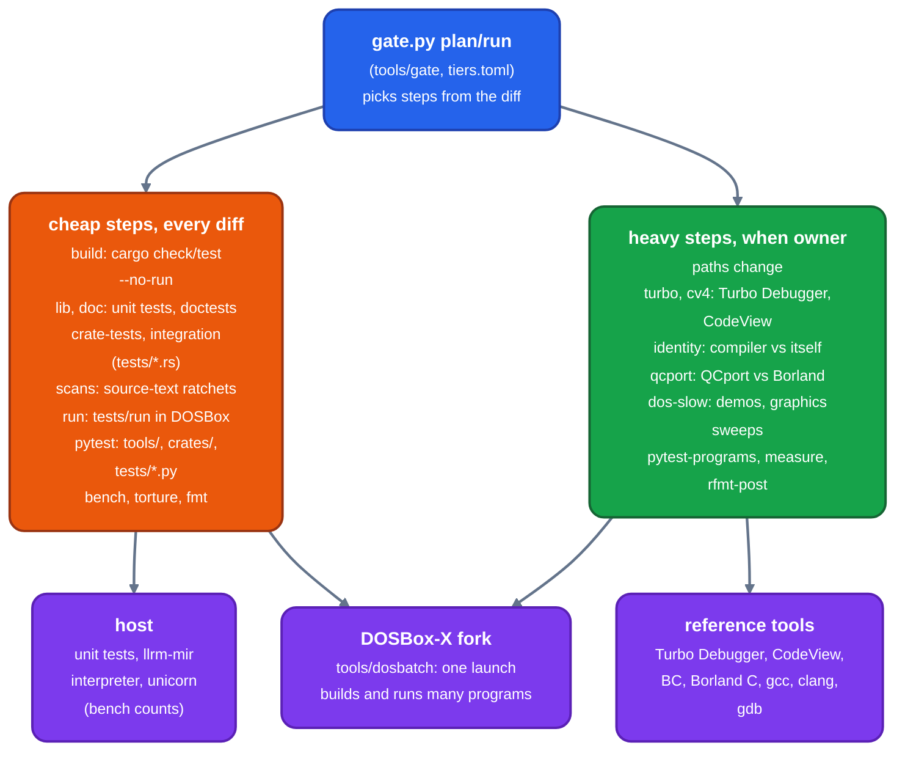

# Running the tests

For contributors: which tests exist, how to run the narrowest one that answers a question, and what the gate runs for a diff.

## Layers

*What the gate runs for a diff, and what executes the program under test*

A step whose tool is not in the repository is SKIPPED with the reason (see CI).

What the gate and CI require is in [gate](gate.md).

## Fast tests

    cargo test --release -p CRATE <filter>         unit tests of one crate
    cargo test --release --test NAME [filter]      one root test binary, tests/NAME.rs
    cargo test --release <filter>                  the narrowest tests that answer the question

Unit tests sit beside their module (`*_tests.rs`); a crate's integration tests are in its `tests/`. Root tests in `tests/*.rs`
compile C, Nib or BASIC through the built binaries and assert on the object or listing.

Cargo features (`Cargo.toml`) select what the build script fetches and builds: `jw` (jwasm, jwlink), `dosrun` (the DOSBox-X fork); `toolchain`, the default, is both.

    cargo test --release --no-default-features --test docs_links     needs no toolchain

`tests/toolchain.rs` builds programs with the bootstrapped DOS toolchain and runs them.

`cargo test --profile fast` trades code quality for rebuild time after a one-line edit (`[profile.fast]`).

## What belongs in the suite

Tests assert program behavior, representation invariants, or a named regression. Exact corpus totals and coverage shares are
measurements: keep them in the reporting tools, not in assertions that fail when fixtures or the pipeline change.

Tests the gate lists as source scans (`[[scan]]` in `tiers.toml`) read the tree's source text and fail when a file gains a
pattern. A test that reads sources and is not listed there fails `tools/gate/test_gate.py`.

## Formatting

    tools/fmt.sh            format the tree (nightly rustfmt, then tools/rfmt-post)
    tools/fmt.sh --check    list what would change, change nothing
    tools/fmt.sh --stdin FILE

Plain `cargo fmt` is not enough: it leaves the method chains and `matches!` calls that `tools/rfmt-post` lays out. Code lines go to
column 120, comments to 80. `--check` fails on a comment past 80 unless it is one word (a URL), a code block or a table row.

## The gate

    python3 tools/gate/gate.py plan             what the diff against origin/main selects
    python3 tools/gate/gate.py run              run it
    python3 tools/gate/gate.py run --steps lib integration     only these steps
    python3 tools/gate/gate.py main             full tier over origin/main, bisects a red

`--base REF` changes the diff's base, `--tier fast|full` overrides the choice, `--group G` runs one CI group. `JOBS=N` sets how many
steps run at once (default 4); `CARGO_TARGET_DIR` names the target directory.

`tools/gate/tiers.toml` is the only place a path is tied to a test. The fast tier runs every cheap step plus each heavy step
(`[[heavy]]`) whose owner paths the diff touches. The full tier runs everything and is chosen when the diff touches IR, support,
target descriptions or the workspace manifests (`[shared]`), or a path no table knows. A diff of only `[inert]` paths (docs,
editors) runs nothing. Backend and transform changes take the fast tier plus every codegen step.

A lib step runs the tests in random order: each test binary prints its seed, and `LLRM_SHUFFLE_SEED=N` repeats it. A step that
exits 77 is SKIPPED. `GATE_STALL_MINUTES` (default 10) kills a step that prints nothing.

### CI

`.github/workflows/ci.yml` runs the same gate on every pull request and on main, as a status nothing waits for. `gate.py plan --json`
picks the tier and the job groups (`[groups]` in `tiers.toml`); one build job makes the target directory and the groups run in
parallel on it.

A step that needs a tool not in the repository (Turbo C++, CodeView, QCport's Borland C, QuickBASIC, `perf`) is SKIPPED with
the reason, and a run language or test binary that needs one is dropped by name. This happens only with `GATE_ALLOW_MISSING=1`,
which only the workflow sets. `[capability.*]` in `tiers.toml` names each tool, the variable that locates it and a file to look
for. Hosted runners have no instruction counters, so CI always skips `measure` and the tests that read counters.

## Programs run in DOSBox

`tests/run/{qb,c,nib,alias,huge}` and `examples/` hold programs with a `NAME.out` of what they print. `tests/run.rs` calls
`tools/dosbatch/run_tests.py`, which compiles each, runs them all in one DOSBox-X launch and diffs stdout with `NAME.out`.

    cargo test --release --test run
    python3 tools/dosbatch/run_tests.py [qb|c|nib|NAME]... [--work DIR]
    LLRM_RUN_ONLY='c nib' cargo test --release --test run

A program's header comment holds its settings (`flags`, `dialect`, `link`, `stdin`, `data`, `mask`, `known`, `targets`); the
docstring of `run_tests.py` lists them. A `known: #N` program that passes fails the run: remove its mark.

`bench/NAME/` is built and run the same way; see [bench](../../bench/readme.md).

`tools/dosbatch/test_*.py` test the runner and the DOS-side runtimes with pytest:

    uv run --project tools python -m pytest tools/dosbatch/test_dosbatch.py -q
    uv run --project tools python -m pytest tools/dosbatch -m slow_dos       the demos and graphics sweeps

The slow tier needs `-m slow_dos` or `LLRM_DOS_SLOW=1` and Microsoft's NIBBLES.BAS and GORILLA.BAS (`QB45_DEMOS_DIR`). The demos are played in lockstep with the emulator on virtual time ([debugging](debugging.md)): the same picture sequence at any host speed; a play takes 1.5 to 2.5 s more of wall than it did on host-timed waits.

The DOSBox-X is the fork's `dosrun` branch, built by `toolchain/dosrunbuild.sh` into the target directory. Set `DOSBOX_BIN` to use
another.

## Differential tests

`tests/differential.rs` runs two scripts:

- `tools/dosbatch/run_differential.py`: each program of `tests/differential/qb-bc` through `llrm-qb` and through Microsoft's `BC`
  under the program's switches, and compares what they print;
- `tools/dosbatch/run_conformance.py [PROFILE...]`: the cases of [`tests/differential/conformance`](../../tests/differential/conformance/readme.md),
  each on its own dialect's runtime against its expected output.

`tools/e2e/e2e.py CONFIG` is the one route that feeds BC's own objects through `llrm-omf`; `--dry-run` lists what it would do.

## Every program compiles

`tests/test_programs_compile.py` compiles every program `tools/sizes.py` builds (the suite, bench and examples) at -O2 with the
release binaries. A program that fails and is not in `tools/sizes-known.txt` fails the test, and so does a listed one that
compiles: the list may only shrink. It is skipped, loudly, when the binaries are missing or older than the sources;
`LLRM_REQUIRE_BINARIES=1` makes that a failure.

    uv run --project tools python -m pytest tests/test_programs_compile.py -rs

Binaries are found at `LLRM_BIN`, else `$CARGO_TARGET_DIR/release`, else `target/release` (`tools/llrmbin.py`).

## Identity

`tools/identity.sh` proves a change left a target's code alone: two builds make byte-identical objects for a whole corpus. The
gate runs it as the `identity` step; [tools](../../tools/readme.md) describes its use.

## Debug information

`tests/dwarf.rs` and `crates/mc/llrm-dwarf` run llvm-dwarfdump, gdb, ld and as over the DWARF llrm writes; `tests/turbo.rs` and
`tests/cv4.rs` drive Turbo Debugger and CodeView sessions. A test whose tool is missing prints `SKIPPED: why` and passes; with
`LLRM_REQUIRE_DWARF=1` (`LLRM_REQUIRE_TURBO`, `LLRM_REQUIRE_CODEVIEW`, `LLRM_REQUIRE_WDUMP`) it fails instead. A host that has the
tools sets them all with `. tools/debug-gate.env`.

## External corpora

QCport, the largest C program llrm-cc compiles, is not in this repository. Its variables are `QCPORT` (its `src`), `QCPORT_INC`
(the Borland headers) and, to run it, `QCPORT_BORLAND` (the all-Borland build) and `JWLINK`.

    tools/qcport-compile.sh                 every module at -O2 and -Os; each refusal is listed
    tools/qcport-run-cc.py                  links the llrm-cc build, runs it headless beside the Borland build, compares frames,
                                            polygons and the md5 of BENCH.BMP

`QCPORT_OBJECTS` reuses objects the gate already built; `QCPORT_RUN_SECONDS` caps each run. Run both before merging a change to
llrm-cc, HIR, its verifier or MIR lowering.

`tools/torture/torture.py` builds GCC's `gcc.c-torture/execute` (`TORTURE_CORPUS` names the directory) at -O0, -O2 and -Os for m32
and runs each program on the emulator; a program passes by exiting 0. Every program ends in one class: pass, refused by design
(`tools/torture/expected.toml` `[[refused]]`), differs by design (`[[differs]]`), or a finding. None is skipped quietly. The
gate runs `--gate`, the fixed sample of `tools/torture/sample.txt`. The run stage splits the programs over up to 12 DOSBox launches at once, each in its own work directory (50 s against 291 s in serial batches of 150).

    uv run --project tools python tools/torture/torture.py [names...] [--levels O0,O2,Os] [--stage compile] [--out results.json]

`tools/loops/run.py` judges loop code over a corpus of cases in C, QB 4.5 and Nib; `--quick` is the short run. It is described in
[tools](../../tools/readme.md).

## Compile cost

`tools/measure.py check` (gate step `measure`, run when the backend, transforms, front end or x86 targets change) compares this
tree's `llrm-cc` with the same measurement of the commit it branches from, in user-space instructions (`perf stat -e instructions:u`),
so host load does not move them: the compile of the vsgcc programs and QCport's modules per level (`tools/compile-cost.py`), the
cost at N/2, N and 2N on generated programs per axis (`crates/target/llrm-x86-m32/vsgcc/scaling_gate.py`), and each compile step
with a large enough share of the work (`LLRM_DEBUG=time`'s `[instr]` rows).

A measurement is stored per commit in `~/.cache/llrm/measure` (`LLRM_MEASURE_DIR`); a missing base is built in its own tree and
target directory and measured with this tree's tools. The tolerances are `[measure]` in `tiers.toml`. Without a working counter the
step exits 77. `measure.py compare BASE SHA` compares two stored measurements; `measure.py creep` (run by `gate.py main`) compares
a main commit with one 50 merges or a week back.

The cost gate and the counter tests measure `dist` (`[profile.dist]`: one codegen unit, fat LTO), the shipped `llrm-cc`: base and head are
each built with `llrm-cc` alone (`tools/measure.py`, `MEASURE_BUILDS`), the base beside the head, and a binary of another profile is
refused. Under `release` (16 codegen units) an edit to one file re-partitions the units and flips the inlining of unrelated functions: the
same pair (#1977) read +0.46..0.61% on its gate shapes there and +0.01..0.04% under `dist`. `tools/abmeasure.py PARENT HEAD` is the one
way to quote a delta of the compiler's own cost. The other gate steps still build `release`.

Work done by a shared engine is timed under the engine's own span, and a step's row is only its own code. Moving a step's work into
an engine that runs inside another step's span raises that step's row even where the total falls; give the engine its own span rather
than move the tolerance. A flagged step row names the steps of its axis and level whose cost at 2N rose most: the callee that took
the work is among them.

See [measurement](measurement/readme.md) for what each number means and [metal](../machine/metal.md) for the one question a model
cannot answer.
