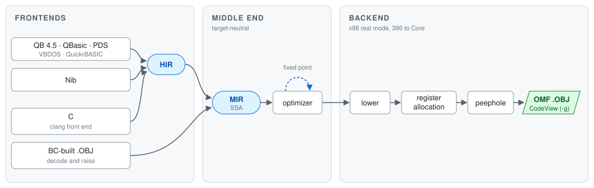

# llrm -- Low Level Real Machine

`llrm` is a compiler suite for 16-bit real-mode DOS (and a flat 32-bit DOS target) that aims at GCC/LLVM-quality
code. Every frontend raises to one SSA IR (MIR), shares one optimizer and x86 backend, and writes linkable OMF
`.OBJ` files. For people who build llrm, use its compilers or work on it; documentation starts at [docs](docs/readme.md), and
[comparison](docs/comparison/readme.md) sets its output beside other compilers'.



MIR passes are machine-independent; only lowering, allocation and peephole see registers or instructions
([the MIR boundary](docs/architecture/split.md)). The goal is output within 1.5x of a hand-derived modern-compiler
listing for every suite program; [measurement](docs/working/measurement/readme.md) says how it is measured.

## Programs

Each is built from `src/bin`. `llrm-qb` is the default `cargo run` target.

| Program | Does |
|---|---|
| `llrm-qb` | QuickBASIC-family source (QB 4.5, QBasic 1.1, PDS 7.1, VBDOS, QuickrBASIC) to an object; see [the dialects](docs/frontends/qb/dialects.md) |
| `llrm-cc` | C, through the clang driver, to an object; see [the front end](docs/frontends/c/readme.md) |
| `llrm-nib` | Nib, llrm's own language, to an object; see [the language](docs/frontends/nib/readme.md) |
| `llrm-omf` | A small input route: objects written by QuickBASIC's BC, raised to MIR and compiled afresh; see [BC objects](docs/frontends/bc.md) |
| `llrm-mir` | Reads and verifies MIR text and writes it back; `--run [--entry NAME] [--fuel N]` runs `@main` on the interpreter; `--ivs` prints each innermost loop's induction-variable count |
| `llrm-run` | Runs a Nib module's entry on the host HIR interpreter: `llrm-run [-m16\|-m32] SOURCE.nib [ENTRY] [INTEGER...]` |
| `nibfront` | Nib's front end alone: `--tokens`, `--syntax`, or `--declare h\|bi\|inc` for C, QuickBASIC and assembler declarations of a module |
| `nib-lsp` | Nib's language server; see [the server](docs/frontends/nib/lsp.md) |

Floating point is native x87, so a coprocessor is required. The crates behind these programs are in
[crates](docs/reference/crates.md).

## Build

```sh
cargo build --release
```

The default feature `toolchain` bootstraps what the compilers and tests need:

| Feature | Builds |
|---|---|
| `jw` | `jwasm` and `jwlink` |
| `dosrun` | the headless DOSBox-X the DOS tests run on |

Their binaries land in `target/<profile>`. Sources are cloned under `$XDG_CACHE_HOME/llrm` (`~/.cache/llrm` when
unset), one tree per pinned commit, made whole or not at all, so worktrees and parallel builds share them safely.
`$OWROOT` names an existing Open Watcom tree to use instead of cloning one. The scripts need a Unix host.

On Debian or Ubuntu the toolchain needs:

```sh
sudo apt install build-essential git autoconf automake libtool libpng-dev libpcap-dev libncurses-dev
```

The Rust toolchain is pinned by `rust-toolchain.toml`. Python tools run through `uv`; see
[the tools](docs/reference/tools.md).

## Use

```sh
target/release/llrm-qb PROGRAM.BAS --dialect qb45 --runtime qb45 -o PROGRAM.OBJ
target/release/llrm-cc --target=x86_16-wat program.c -o PROGRAM.OBJ
target/release/llrm-nib program.nib -o PROGRAM.OBJ
target/release/llrm-omf MAIN.OBJ DRAW.OBJ -o build/optimized -march=i486
```

`llrm-qb`'s default runtime is llrm's own; `--runtime qb45|pds71|vbdos` selects a Microsoft one, and the default
dialect is `vbdos`. `llrm-omf` takes every object of a program in LINK order, ignores `.LIB` arguments, writes
`-o` as the object (one input) or a directory (several), and writes nothing unless every object succeeds.

`llrm-qb`, `llrm-cc`, `llrm-nib` and `llrm-omf` share gcc-named options:

| Option | Does |
|---|---|
| `-O0` `-O1` `-O2` `-O3` `-Omax` `-Os` `-Oz` `-Og` | Optimization level; `-O2` is the default. What each level turns on: [levels](docs/reference/levels.md) |
| `-f[no-]PASS` | One pass on or off by gcc's name, for example `unroll-loops`, `inline-functions`, `strength-reduce`, `gcse`, `tree-dse`; the names are the `PASSES` table in `crates/codegen/llrm-codegen/src/driver/flags.rs` |
| `-march=CPU`, `-mtune=CPU` | The processor, gcc's name for it (`i386` through `core2`) |
| `-m16`, `-m32` | The target; `-fobject-format=omf\|elf\|macho\|coff` its object format |
| `-fsanitize=CHECKS`, `-ftrapv`, `-fwrapv` | Run-time checks: `bounds`, `integer-divide-by-zero`, `signed-integer-overflow`, `stack`, or `undefined` (the first three); see [semantic switches](docs/reference/semantics/readme.md) |
| `-g` | Debug information; see [formats](docs/formats/readme.md) |
| `-S` | Writes the assembly listing instead of an object |
| `--dump DIR` | Writes every stage to `DIR`, for diffing; `llrm-qb`, `llrm-cc` and `llrm-nib` take it, and `LLRM_MIR_STAGES=DIR` does the same for any of them |

`llrm-qb --runtime-frames` calls the runtime's frame entry and exit in every procedure, so its frame chain, stack check
and event poll are there to debug against. `--own-frames` is accepted and does nothing.

One loop in three languages, compiled with `-S` and compared: [examples/dot](examples/dot).
[Loop strength reduction](docs/optimizations/passes/lsr_pass.md) says what the backend does with it.

## Example

One loop in three languages: a dot product of two `int` arrays, returned as a
`long`. The sources are in [examples/dot](examples/dot); each listing is what `-S`
prints with `-march=i486`, and the comments are added by hand. C is in the medium model.

C, `llrm-cc --target=x86_16-wat dot.c -march=i486 -S`:

```c
long dot(const int *a, const int *b, int n)
{
    long total = 0;
    int i;
    for (i = 0; i < n; i++)
        total += (long)a[i] * b[i];
    return total;
}
```

```asm
_dot@3 proc far
L0_0:
    test cx, cx
    jle L0_4294967297               ; [header copy] one guard for n <= 0, ahead of the prologue
L0_17:
    push si                         ; a is in ax, b in dx, n in cx (regparm3); si and di are callee-saved
    push di
    mov si, ax                      ; si = a, an address register: ax cannot address
    mov di, dx                      ; di = b
    add cx, cx                      ; cx = 2n, the byte length of each array
    mov bx, cx
    neg bx                          ; [one induction variable] bx = -2n is the counter and the offset
    add si, cx                      ; [biased] a + 2n, so a[i] is at [bx+si]
    add di, cx                      ; [biased] b + 2n
    xor eax, eax                    ; total = 0
L0_4:
    movsx ecx, word ptr [bx+si]     ; a[i], sign-extended to 32 bits
    movsx edx, word ptr [bx+di]     ; b[i]
    imul ecx, edx                   ; (long)a[i] * b[i]: a 32-bit multiply, no runtime helper
    add eax, ecx                    ; total += product
    add bx, 2                       ; step one int; [flag reuse] its flags end the loop at 0
    jne L0_4
L0_2:
    pop di                          ; the long is already in eax: it returns there
    pop si                          ; no frame: nothing is on the stack
    retf
L0_4294967297:
    xor eax, eax                    ; n <= 0: no saved registers were touched
    retf
_dot@3 endp
```

Nib, `llrm-nib dot.nib --entry dot -march=i486 -S`:

```
fn dot(a: &[i16], b: &[i16]) -> i32:
    let mut total: i32 = 0
    for (x, y) in zip(a, b):
        total += i32(x) * i32(y)
    return total
```

```asm
_dot proc far
    push bp                     ; a is the far pointer [bp+6], b [bp+10]
    mov bp, sp
    sub sp, 6
    push si
    push di
L0_1:
    les di, dword ptr [bp+6]
    mov cx, word ptr es:[di]
    lfs bx, dword ptr [bp+10]
    mov ax, word ptr fs:[bx]
    mov word ptr [bp-4], ax
    test ax, ax
    sete al
    mov word ptr [bp-2], cx
    test cx, cx
    sete cl
    or cl, al
    xor eax, eax
    test cl, cl
    jne L0_3
L0_2:
    mov cx, 1
    mov ax, word ptr es:[di+4]
    mov word ptr [bp-6], ax
    mov es, word ptr es:[di+6]
    mov di, word ptr fs:[bx+4]
    mov fs, word ptr fs:[bx+6]
    xor eax, eax
L0_4:
    mov edx, eax
    lea bx, [ecx+ecx]
    mov si, word ptr [bp-6]
    movsx esi, word ptr es:[bx+si-2]
    movsx eax, word ptr fs:[bx+di-2]
    imul eax, esi
    add eax, edx
    cmp cx, word ptr [bp-2]
    jae L0_3
L0_5:
    mov dx, cx
    inc dx
    cmp cx, word ptr [bp-4]
    mov cx, dx
    jb L0_4
L0_3:                           ; cx = min(len(a), len(b)): zip ends with the shorter slice,
    pop di                      ; the long is in eax, where it returns
    pop si
    leave
    retf
_dot endp
```

A Nib slice is a far pointer to its length and data pointer. `zip` pairs the
elements until the shorter slice ends, so there is no `n`, and no index to check.
Indexing, `a[i]`, checks every access and calls `N$EBND` on a bad one.

BASIC, `llrm-qb dot.bas --dialect pds71 --runtime qb45 -march=i486 -O3 --whole-program -fno-inline=DOT -S` (DOT is called once, and would go into its caller):

```basic
DECLARE FUNCTION Min% (BYVAL x AS INTEGER, BYVAL y AS INTEGER)
DECLARE FUNCTION Dot& (a() AS INTEGER, b() AS INTEGER)

n = 9: m = 7
REDIM p(n) AS INTEGER, q(m) AS INTEGER
PRINT Dot&(p(), q())

FUNCTION Min% (BYVAL x AS INTEGER, BYVAL y AS INTEGER)
    IF x < y THEN Min% = x ELSE Min% = y
END FUNCTION

FUNCTION Dot& (a() AS INTEGER, b() AS INTEGER)
    DIM total AS LONG, i AS INTEGER
    FOR i = 0 TO Min%(UBOUND(a), UBOUND(b))
        total = total + CLNG(a(i)) * b(i)
    NEXT
    Dot& = total
END FUNCTION
```

```asm
DOT proc near
L1_1:
    mov dx, word ptr P%+14
    mov ax, dx
    dec ax
    mov cx, word ptr Q%+14
    mov bx, cx
    dec bx
    cmp ax, bx
    jl L1_11
L1_10:
    mov ax, bx
L1_11:
    test ax, ax
    js L1_2_1
L1_2:
    push bp                     ; a plain frame, not B$ENRA; near, as --whole-program
    mov bp, sp                  ; sees every caller. a() is [bp+6], b() [bp+4]
    sub sp, 2
    push si
    push di
    xor eax, eax
    mov es, word ptr P%+2
    mov si, word ptr P%+10
    mov fs, word ptr Q%+2
    mov di, word ptr Q%+10
    dec cx                      ; UBOUND(b)
    dec dx
    cmp cx, dx
    jl L1_26
L1_25:
    mov cx, dx
L1_26:
    inc cx
    xor bx, bx
    mov word ptr [bp-2], di
L1_3:
    movsx edx, word ptr es:[bx+si]
    mov di, si
    mov si, word ptr [bp-2]
    movsx esi, word ptr fs:[bx+si]
    imul esi, edx
    add eax, esi
    mov si, di
    add bx, 2                   ; [flag reuse] the step's flags end the loop at 0
    dec cx
    jne L1_3
L1_4:
    shld edx, eax, 16           ; the long returns in DX:AX
    pop di
    pop si
    leave
    ret
L1_2_1:
    xor eax, eax
    shld edx, eax, 16
    ret
DOT endp
```

An array is a descriptor: its segment goes in `es` or `fs` before the loop.
`UBOUND` is two loads and a decrement: the rank is the declaration's, so the count's
slot is fixed, and nothing tests that the array is allocated, as BC does not without
`/D`. `-fsanitize=bounds` brings the test and the cold `B$UBND` call back, except
where every caller passes an array a `DIM` or `REDIM` dominates, as here. Where a
procedure's own `DIM` or `REDIM` states a bound, `UBOUND` is that value and reads nothing.
The frame is a plain one, not the runtime's `B$ENRA` and `B$EXSA`.
`Min%` takes its arguments `BYVAL` and the build is `--whole-program`, which is what
lets the inliner take it; by reference it stays a call
([#114](https://github.com/ali-mosavian/llrm/issues/114)).

All three compile to the same loop: six instructions, one induction variable.
Loop strength reduction ([#98](https://github.com/ali-mosavian/llrm/issues/98))
biases each array's base by its byte length, so the counter, running from minus
that length up to zero, is also the offset of every access, and its flags end the
loop. The product is a 32-bit `imul` in `eax`, without a runtime call.

## Validate

```sh
cargo test --release <name>
uv run --project tools python tools/loops/run.py --quick
```

The second command runs the loop corpus: one loop program per case, emitted as C, QuickBASIC and Nib and checked
against an independent oracle and against hand-derived quality bounds. [Testing](docs/working/testing.md) has the
rest; [debugging](docs/working/debugging.md) finds a miscompile in a running DOS program.

Format with `tools/fmt.sh`.
